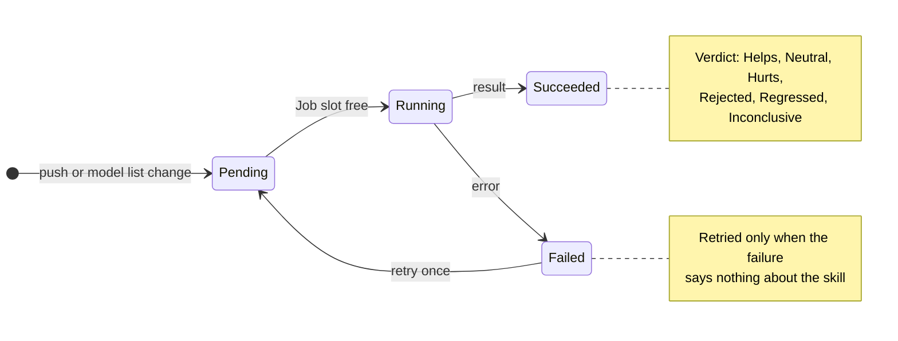

<div class="statement">
  <p class="statement__kicker">It's 2026.</p>
  <h1>Skills are <em>big business</em>.</h1>
</div>

<!--
[0:30 to 0:45]

It's 2026 and skills are big business. Look at your own company: it's highly
likely that every team ships agent skills by now.
-->

---

<div class="proof">
  
  
  
  
</div>

<style scoped>
/* Captures scattered on the slide like prints on a table: each click drops one more on top. */
.proof { position: absolute; left: 0; top: 0; width: 1920px; height: 1080px; }
.proof__img {
  position: absolute; display: block; border-radius: 18px; border: 1.5px solid var(--p-border); background: #fff;
  box-shadow: 0 30px 70px rgb(0 0 0 / 0.22), 0 4px 14px rgb(0 0 0 / 0.12);
  transform: rotate(var(--r)) scale(1); opacity: 1;
  transition: transform 0.55s cubic-bezier(0.2, 0.9, 0.3, 1.15), opacity 0.35s ease-out;
}
.proof__img.slidev-vclick-hidden { transform: rotate(calc(var(--r) * 2.5)) scale(1.18); opacity: 0; }
.proof__img--profile { --r: -5deg; height: 660px; left: 130px; top: 70px; }
.proof__img--tweet { --r: 4deg; height: 690px; left: 1060px; top: 50px; }
.proof__img--card { --r: -2deg; width: 900px; left: 500px; top: 470px; }
/* The last click takes over the whole slide, footer included. */
.proof__img--installs { --r: 0deg; position: fixed; left: 0; top: 0; width: 1920px; height: 1080px; object-fit: cover; object-position: top; border: 0; border-radius: 0; background: #000; z-index: 20; }
.proof__img--installs.slidev-vclick-hidden { transform: scale(1.08); opacity: 0; }
</style>

<!--
[0:45 to 1:25]

This is Matt Pocock. He teaches TypeScript for a living, 383K followers on X.
[click] In October, this post went around: his skills repo has more stars than
React, and the most installed skill in it is one line long.
[click] The repo itself: "Skills for Real Engineers. Straight from my .agents
directory." 309k stars, 26k forks. One person's skills folder, installed by a
few hundred thousand engineers.
[click] And the installs: search skills.sh for him and nine of his top ten
skills have a million or more. grill-me alone, 1.5 million.

Captures from 2026-11-01 with the microlink.io screenshot API, cropped: the X
profile and the post by @thehypekevin of 2026-10-09
(x.com/thehypekevin/status/2108598006748794896), plus the GitHub social card
of github.com/mattpocock/skills, and the skills.sh search for "mattpocock"
(skills.sh/?q=mattpocock, microlink capture at 1280px wide, top ten rows;
56 skills, 31.2M installs in total on skills.sh/mattpocock/skills). The React comparison is the post's claim.
TODO: re-time from here on; the hands-up windows below still start at 0:45.
-->

---
layout: full
---

<Meme src="/memes/legend.jpg" fit="contain" />

<!--
[1:25 to 1:35]

Pause on it. One line, three hundred thousand stars.

Image: "Fucking legend" meme, via ifunny.co, with the ifunny bar cropped off.
-->

---

<div class="statement">
  <h1>Every team ships <em>skills</em> by now.</h1>
</div>

<!--
[2:00 to 2:20]

Skills are sprawling. Every team writes its own, in its own repo, with its
own idea of "works". Nobody asks the platform team, because a skill is just
a folder.
-->

---

# We definitely do

<div class="repos">
  
  
</div>

<style scoped>
.repos { position: relative; height: 780px; margin-top: 0; }
.repos__img {
  position: absolute; display: block; border-radius: 16px; border: 1.5px solid var(--p-border); background: #fff;
  box-shadow: 0 30px 70px rgb(0 0 0 / 0.2), 0 4px 14px rgb(0 0 0 / 0.1);
  transform: rotate(var(--r)); opacity: 1;
  transition: transform 0.55s cubic-bezier(0.2, 0.9, 0.3, 1.15), opacity 0.35s ease-out;
}
.repos__img.slidev-vclick-hidden { transform: rotate(calc(var(--r) * 2.5)) scale(1.15); opacity: 0; }
.repos__img--public { --r: -2deg; width: 1100px; left: -20px; top: 0px; }
.repos__img--internal { --r: 2.5deg; width: 1080px; left: 700px; top: 150px; background: #0d1117; }
</style>

<!--
[about 15 seconds]

And Pulumi? We definitely do. This is our public one, pulumi/agent-skills:
official Pulumi skills for writing, migrating and operating infrastructure,
shipped as plugins for Claude Code, Codex, Cursor and Gemini CLI.
[click] And next to it, the internal one, pulumi/pulumi-skills-internal:
skills for our own workflows, customer research, analytics, engineering.
215 commits, 84 branches, 17 contributors. Only our own teams see it.

Capture of github.com/pulumi/agent-skills on 2026-11-02 (Playwright, light
mode, GitHub's top bar cropped): 78 stars, 8 forks, Apache 2.0.
pulumi/pulumi-skills-internal is internal: screenshot from a logged-in
browser, dark mode, from the speaker's own browser on 2026-11-02; GitHub's top bar and the
Contributors section (avatars) cropped off.
-->

---

<div class="statement statement--long">
  <ph-hand-waving class="statement__icon" />
  <h1>Hands up if you use <em>skills</em>.</h1>
</div>

<!--
[0:45 to 1:00]

Show of hands. Who uses skills, in Claude Code, Codex, Cursor, anywhere?
Keep them up. That's most of the room.
-->

---

<div class="statement statement--long">
  <ph-hand-waving class="statement__icon" />
  <h1>Hands up if you have a central skills <em>repo</em>.</h1>
</div>

<!--
[1:00 to 1:15]

Keep your hand up if your team or company has a central skills repo, one
place the skills come from.
-->

---

<div class="statement statement--long">
  <ph-hand-waving class="statement__icon" />
  <h1>Hands up if you created <em>evals</em> for them.</h1>
</div>

<!--
[1:15 to 1:30]

Keep it up if you created evals for those skills. Test cases you can run, not
a feeling.
-->

---

<div class="statement statement--long">
  <ph-hand-waving class="statement__icon" />
  <h1>Hands up if you <span class="whitespace-nowrap">re-run</span> evals when the <em>model changes</em>.</h1>
</div>

<!--
[1:30 to 1:50]

And keep it up if you re-run those evals when the model changes. Or the agent
gets a new release.

Count what you see and say it out loud ("about three hands"). The drop from
the first question to the last is the gap this talk is about.
-->

---
layout: full
---

<Meme src="/memes/this-is-fine.jpg" fit="contain" top="MODEL UPDATE" bottom="SKILL.md" keep-case :size="5" />

<!--
[1:50 to 2:00]

That's the usual answer. The model changes, the skills stay, and we assume
it's fine.

Template: "This Is Fine" (KC Green), via imgflip.
-->

---
layout: cover
---

<div class="absolute inset-0 flex flex-col justify-center items-start px-20">
  <div class="event">KubeAuto Day North America 2026 · Salt Lake City · November 9, 2026</div>
  <h1 class="!text-[7.6rem] !leading-[1.02] !font-semibold !tracking-tight !m-0 !max-w-[92%]">
    Skills Are<br />Packages Now.
  </h1>
  <p class="sub">Your platform should treat them that way.</p>
  <div class="speaker" v-click>
    
    <div>
      <div class="speaker__name">Engin Diri</div>
      <div class="speaker__role">Principal Solutions Architect, Pulumi</div>
      <div class="speaker__handles">
        <span><carbon-logo-x /> @_ediri</span>
        <span><carbon-logo-linkedin /> engin-diri</span>
        <span><carbon-logo-github /> dirien</span>
      </div>
    </div>
  </div>
</div>

<style scoped>
.event { font-family: var(--slidev-font-mono); font-size: 0.95rem; font-weight: 700; letter-spacing: 0.04em; text-transform: uppercase; color: var(--p-primary); margin-bottom: 2rem; }
.sub { margin: 1.6rem 0 0 !important; font-size: 2.9rem !important; line-height: 1.2 !important; color: var(--p-fg-muted) !important; max-width: 90% !important; }
.speaker { display: flex; align-items: center; gap: 1.6rem; margin-top: 3.4rem; }
.speaker img { width: 7.5rem; height: 7.5rem; border-radius: 9999px; object-fit: cover; border: 3px solid color-mix(in srgb, var(--p-primary) 45%, transparent); }
.speaker__name { font-size: 1.8rem; font-weight: 600; color: var(--p-fg); }
.speaker__role { font-size: 1.3rem; color: var(--p-fg-muted); margin-top: 0.2rem; }
.speaker__handles { display: flex; gap: 1.6rem; margin-top: 0.6rem; font-size: 1.05rem; color: var(--p-fg-muted); }
.speaker__handles span { display: inline-flex; align-items: center; gap: 0.4rem; }
</style>

<!--
[after the cold open, about 30 seconds]

So, now that the fire is burning: good afternoon, KubeAuto. I'm Engin, I
work at Pulumi on platform tooling.
[click] Quick thank-you to the organizers for putting this day next to
KubeCon. 25 minutes: a problem, a platform answer, how it ships, a demo,
and a recap you can take home.

TODO: confirm the session start time and whether Q&A is inside the 25 minutes.
-->

---

# What's in a skill

<div class="grid grid-cols-[1.25fr_1fr] gap-8 mt-2 items-stretch zm">
  <div class="gpu-card gpu-card--primary tree" v-click>
    <div class="gpu-caption gpu-caption--accent">The folder (agentskills.io)</div>

```text
my-skill/
├── SKILL.md       name, description, metadata
├── scripts/       code the agent runs
├── references/    docs, read on demand
├── assets/        templates, schemas, data
└── evals/
    ├── evals.json the test cases
    └── files/     their input files
```

  </div>
  <div class="gpu-card gpu-card--muted" v-click>
    <div class="gpu-caption gpu-caption--muted">It already has</div>
    <ul class="anatomy">
      <li><strong>A name, a description</strong>: when to load it</li>
      <li><strong>A license, an author, a version</strong> in <code>metadata</code></li>
      <li><strong>Code and data</strong> next to the instructions</li>
      <li><strong>Tests</strong>: <code>evals/evals.json</code></li>
    </ul>
  </div>
</div>

<style scoped>
.tree :deep(pre), .tree :deep(code) { font-size: 0.86rem !important; line-height: 1.55 !important; }
.anatomy { list-style: none; padding: 0; margin: 1rem 0 0 !important; display: flex; flex-direction: column; gap: 0.9rem; }
.anatomy li { margin: 0 !important; font-size: 1.25rem !important; line-height: 1.3 !important; }
.anatomy strong { color: var(--p-fg); }
</style>

<!--
[2:20 to 2:50]

A skill is a folder. [click] SKILL.md is the only required file: YAML
frontmatter with a name and a description, then the instructions. Next to it
the spec allows scripts the agent runs, references it reads when it needs
them, and assets like templates or schemas. And an evals folder: evals.json
holds test cases, a prompt, a description of the expected output, and
assertions, with input files under evals/files.

[click] So it already carries a lot: a name, a license, an author
and a version in the metadata, code and data, and tests.

If there is time: it even loads lazily. Only name and description sit in the
context, about 100 tokens per skill, until the skill triggers.

The demo skills are small on purpose: SKILL.md and evals/. Version 1.1.0 of
k8s-resource-naming adds a scripts/ folder, which is exactly what the Tier 1
security scan reads in step 2 of the demo.

Sources: agentskills.io/specification (layout, frontmatter: name and
description required; license, compatibility, metadata, allowed-tools
optional); agentskills.io/skill-creation/evaluating-skills (evals/evals.json:
skill_name, evals[] with id, prompt, expected_output, files, assertions);
platform.claude.com/docs/en/agents-and-tools/agent-skills/overview (the three
loading levels and their token budgets); docs.port.io/agent-management/skills
(the same layout with references/ and assets/).
-->

---

# A skill depends on a model and a harness

<div class="diagram-slide">
  <Diagram name="dependencies" alt="A skill depends on the model and on the agent harness, and nothing checks either" />
</div>

<style scoped>
.diagram-slide { height: 33rem; margin-top: 0.4rem; }
</style>

<!--
[2:50 to 3:50]

Like any software, a skill has dependencies. It is written against a
model. That is the first dependency. It is also
run by an agent harness, Claude Code, Codex, OpenCode, each with its own
release train. That is the second. Nothing checks that the skill still works
when either one changes.

If someone asks about the model field: Claude Code's skill frontmatter has
one, but it is a Claude Code extension that switches the model for the rest
of the turn ("isn't saved to settings"), not a statement of what the skill
was tested with. The open agentskills.io spec has no model field, and harnesses
ignore fields they don't know. There is no field for the harness version;
compatibility is free text that Claude Code "accepts but doesn't act on".

Proof that the harness matters, not just the model: SkillsBench v4 (June
2026) ran the same model under two harnesses. Claude Opus 4.7 gains 18.2
points from curated skills in Claude Code and 11.1 in OpenHands. Gemini 3.1
Pro: 24.8 in Gemini CLI, 19.0 in OpenHands. GPT-5.5: 19.7 in Codex, 15.8 in
OpenHands. Finding 3 of the paper: "Harness choice materially changes how
the same model uses Skills." The harness decides where skills are found
(.claude/skills, .agents/skills, .opencode/skills), which frontmatter it
reads (model, context and allowed-tools are Claude Code fields; Codex keeps
its policy in agents/openai.yaml; OpenCode ignores unknown fields), and how
a skill is loaded (a Skill tool, a skill tool, or reading the file).
Anthropic says the same about the model, in its skill-creator guide
(2026-03-03): "a skill that worked well last month might behave differently
today." And if the base model passes the evals without the skill, "The skill
isn't broken; it's just no longer necessary." Re-running evals also tells
you when to retire a skill.
Careful: SkillsBench compares harnesses, not releases of one harness. For
releases, the Claude Code docs version-gate skill behavior (for example
skill name matching needs v2.1.228 or later), so a release can change it;
nobody has published a measurement of that yet.

In the demo the harness is pinned: Claude Code 2.1.292, Codex 0.161.0,
OpenCode 1.19.1. A new release of any of them can change how a skill is found
and followed. Same folder, different result.

Sources: arxiv.org/abs/2602.12670 v4 (SkillsBench, Finding 3 and Table 2);
claude.com/resources/articles/improving-skill-creator-test-measure-and-refine-agent-skills;
code.claude.com/docs/en/skills; learn.chatgpt.com/docs/build-skills (Codex);
opencode.ai/docs/skills; README.md "Agents and their versions", CONTRACT.md
"Agent versions";
code.claude.com/docs/en/skills (frontmatter reference: model, compatibility);
agentskills.io/specification (no model field).
Drawn in Excalidraw: slides/diagrams/dependencies.excalidraw.
-->

---
layout: full
---

<Meme src="/memes/im-helping.jpg" fit="contain" bottom="SKILL.md" keep-case :size="6" />

<!--
[3:50 to 4:00]

SKILL.md: I'm helping. And the other thing we skip: a skill can make the
agent worse, even a good one. You cannot tell by reading it. People have
measured it.

Image: Ralph Wiggum, "I'm helping" (The Simpsons), via pbs.twimg.com
(media/EOX_2n_WsAAhdZE), 500 x 360, shown with the blurred backdrop.
-->

---

# Skills help, or not? Can you tell?

<div class="grid grid-cols-3 gap-8 mt-6 zm">
  <div class="gpu-card gpu-card--primary ev" v-click>
    <div class="gpu-caption gpu-caption--accent">ACES</div>
    <div class="ev__big">72.8%</div>
    <p>of 947 paired runs improved with the skill: 58 production skills, four harnesses</p>
    <div class="src">arxiv.org/abs/2608.20614</div>
  </div>
  <div class="gpu-card gpu-card--primary ev" v-click>
    <div class="gpu-caption gpu-caption--accent">SkillsBench</div>
    <div class="ev__big">13 of 87</div>
    <p>tasks got worse with curated skills, though every agent and model pair gained overall</p>
    <div class="src">arxiv.org/abs/2602.12670v4</div>
  </div>
  <div class="gpu-card gpu-card--primary ev" v-click>
    <div class="gpu-caption gpu-caption--accent">Anthropic</div>
    <div class="ev__quote">“A skill that worked well last month might behave differently today.”</div>
    <div class="src">skill-creator guide, claude.com, 2026-03-03</div>
  </div>
</div>

<style scoped>
.ev { display: flex; flex-direction: column; gap: 1rem; }
.ev__big { white-space: nowrap; font-size: 3.1rem; font-weight: 600; letter-spacing: -0.04em; line-height: 1; color: var(--p-fg); }
.ev__quote { font-size: 1.75rem; font-weight: 600; letter-spacing: -0.03em; line-height: 1.2; color: var(--p-fg); flex: 1; }
.ev p { margin: 0 !important; font-size: 1.5rem !important; line-height: 1.3 !important; flex: 1; }
</style>

<!--
[4:00 to 5:30]

Three data points, all public. They say the same thing: skills usually
help, and you cannot see from the folder which ones don't.

[click] ACES, August 2026, the paper behind NVIDIA's SkillEvaluator, which is
what my stack runs. 947 paired runs, with and without the skill, from 58
production skills on four harnesses. The skill helped in 72.8 percent of
them. So about one in four times, it didn't.

[click] SkillsBench, the June 2026 version: 87 tasks, 18 model and harness
configurations. Every configuration gains from curated skills, plus 16.6
points on average, from 33.9 to 50.5 percent, and smaller models with
skills match larger ones without. And still 13 of 87 tasks got worse; the
worst are exam-block-sequencing and suricata-custom-exfil at minus 7.4
points. Averages hide the tasks where the skill hurts.

[click] And it does not stay put. Anthropic, in the guide for its own
skill-creator, March 2026: "a skill that worked well last month might behave
differently today." The model moved, the skill did not. That is why the
evals have to run again, not once.

Say it out loud: none of this is a reason to skip skills. It's a reason to
test them.

Q&A backup, not on the slide:
- Nick Nisi, WorkOS, AI Engineer Europe 2026 (youtu.be/vy7o1g2iHY8): he
  generated about 10,000 lines of skills from his docs; one of them dropped
  a task from 97 percent correct without it to 77 percent with it. He
  deleted 95 percent of the generated skills, wrote 553 lines of gotchas by
  hand, and the results went up; eval runs went from 68 minutes to 6. He
  does not give that one task's score after the rewrite.
- SWE-Skills-Bench (arxiv.org/abs/2603.15401 v2, 2026-10-27): 92 of 98
  public software-engineering skills had no statistically significant
  effect, 76.6 to 76.9 percent on average, single skills swing +17.7 and
  -17.0. Where the model already knows the domain, most skills add little;
  the few that matter matter a lot. Again: measure which.
- Vercel, "AGENTS.md outperforms skills in our agent evals" (January
  2026): on Next.js 16 tasks, skills with default settings scored 53
  percent, the same as no docs; with explicit instructions 79; an 8 KB docs
  index in AGENTS.md 100. Mostly the agent did not invoke the skill. One
  setup, a harness behavior, and they only knew because they measured.

Fact-checked 2026-11-01: ACES abstract (947 paired cases from 58 of 64
production skills and four harnesses, composite lift positive in 72.8
percent, mean 0.2134, 95% CI 0.1967 to 0.2301); the Anthropic article of
2026-03-03 (quote verbatim, lower-case "a" in the original); SkillsBench v4 (Finding 1
"Every one of the 18 model-harness configurations improves", 13 of 87
negative, 33.9 to 50.5); the Nisi talk transcript: 07:56 "generated over
10,000 lines of skills ... based on our docs", 09:06 "553 lines of
gotchas", 09:19 "6 minutes per run" (68 before, 08:27), 09:33 "the
performance of it actually went up", 09:38 "one skill in particular ...
correct 77% of the time ... without loading the skill, it was correct 97%
of the time".
-->

---
layout: full
---

<Meme src="/memes/one-does-not-simply.jpg" top="One does not simply" bottom="Ship a skill without testing it" :size="5.4" />

<!--
[5:30 to 5:40]

One does not simply ship a skill without testing it. And yet.

Template: "One Does Not Simply" (Boromir, The Lord of the Rings), via imgflip.
-->

---

# What an eval is

<div class="grid grid-cols-3 gap-8 mt-6 zm">
  <div class="gpu-card gpu-card--primary ev2" v-click>
    <div class="ev2__head"><span class="ev2__n">1</span>A test case</div>
    <p>A task for the agent, and checks on the result.</p>
    <div class="ev2__ex"><span>"Write the manifests for the ledger service"</span><span>✓ every resource is in payments-prd</span></div>
  </div>
  <div class="gpu-card gpu-card--primary ev2" v-click>
    <div class="ev2__head"><span class="ev2__n">2</span>Two runs</div>
    <p>The agent does the task with the skill and without it, a few times each. Agents are not deterministic.</p>
    <div class="ev2__ex"><span>with skill × 3</span><span>without skill × 3</span></div>
  </div>
  <div class="gpu-card gpu-card--primary ev2" v-click>
    <div class="ev2__head"><span class="ev2__n">3</span>A score</div>
    <p>A judge grades every run against the checks. The difference is the <strong>lift</strong>.</p>
    <div class="ev2__ex"><span>with 0.90, without 0.45</span><span class="ev2__lift">lift +0.45</span></div>
  </div>
</div>

<style scoped>
.ev2 { display: flex; flex-direction: column; gap: 1rem; }
.ev2__head { display: flex; align-items: center; gap: 0.8rem; font-size: 1.9rem; font-weight: 600; letter-spacing: -0.03em; color: var(--p-fg); }
.ev2__n { flex-shrink: 0; width: 2.4rem; height: 2.4rem; border-radius: 9999px; background: var(--p-primary); color: var(--p-bg); display: inline-flex; align-items: center; justify-content: center; font-size: 1.3rem; font-weight: 700; }
.ev2 p { margin: 0 !important; font-size: 1.4rem !important; line-height: 1.35 !important; flex: 1; }
.ev2 strong { color: var(--p-primary); }
.ev2__ex { display: flex; flex-direction: column; gap: 0.4rem; padding: 0.8rem 1rem; border-radius: 10px; background: var(--p-bg); border: 1px solid var(--p-border); font-family: var(--slidev-font-mono); font-size: 1rem; line-height: 1.4; color: var(--p-fg-muted); }
.ev2__lift { color: var(--p-primary); font-weight: 700; }
</style>

<!--
[about 30 seconds]

Quick refresher, so we mean the same thing by "eval".

[click] A test case: a task you give the agent, and checks on what comes
out. This one is from the demo skill: write the manifests for the ledger
service, and every resource has to land in the namespace payments-prd.
[click] Then you run it twice: with the skill and without it, a few times
each, because the same prompt does not give the same answer twice.
[click] A judge, another model, grades every run against the checks. With
the skill minus without the skill is the lift. That number is what the rest
of this talk moves around.

Numbers: k8s-resource-naming v1.0.0 on Claude Code 2.1.292 with Opus 5.5,
3 cases x 3 trials per arm, 0.90 with, 0.45 without, lift +0.45, interval
[+0.36, +0.54], recorded 2026-11-03 on release 0.12.0 (DEMO.md, "The state before the talk"). The test case is naming-deployment
in skills/k8s-resource-naming/evals/evals.json. In skill-ci an arm runs 3
attempts per case by default (CONTRACT.md, attempts).
-->

---

<div class="statement">
  <h1>That's a classic <em>platform</em> problem.</h1>
</div>

<!--
[5:40 to 5:55]

Many teams, a shared artifact, a moving dependency, nobody owns the quality.
That is a classic platform problem. And platform teams have solved it before.
-->

---

<div class="statement">
  <h1>Platform teams solved this <em>before</em>.</h1>
</div>

<!--
[5:55 to 6:05]

For containers. For infrastructure. For packages.
-->

---

# The same loop, for skills

<div class="grid grid-cols-3 gap-8 mt-6 zm">
  <div class="gpu-card gpu-card--primary loop" v-click>
    <div class="gpu-caption gpu-caption--accent">Registry</div>
    <p><strong>Containers:</strong> images in an OCI registry</p>
    <p><strong>Skills:</strong> every version stored, with release channels</p>
  </div>
  <div class="gpu-card gpu-card--primary loop" v-click>
    <div class="gpu-caption gpu-caption--accent">Pipeline</div>
    <p><strong>Containers:</strong> build, scan, and test on every push</p>
    <p><strong>Skills:</strong> evaluate on every push and every model change</p>
  </div>
  <div class="gpu-card gpu-card--primary loop" v-click>
    <div class="gpu-caption gpu-caption--accent">Gate</div>
    <p><strong>Containers:</strong> promote the tag when it is green</p>
    <p><strong>Skills:</strong> promote to <code>stable</code> when it helps</p>
  </div>
</div>

<style scoped>
.loop { display: flex; flex-direction: column; gap: 1.2rem; }
.loop p { margin: 0 !important; font-size: 1.5rem !important; line-height: 1.3 !important; }
.loop strong { color: var(--p-primary); }
</style>

<!--
[6:05 to 7:00]

You push an image to a registry. A pipeline builds, scans and tests it. A gate
decides which tag moves to production. Nobody asks a human to eyeball it.

[click] Registry: every version of a skill is stored and addressable, with
release channels. Which registry? Hold that thought, it's the best part.
[click] Pipeline: the test run is an eval, with the skill and without it.
It runs when a version is pushed and when the model or harness changes.
[click] Gate: a version that helps gets the stable tag. One that makes the
agent worse stays back.

Skills differ from images, and the loop still transfers.
-->

---
layout: full
---

<Meme src="/memes/freedom-of-speech.jpg" fit="contain" bottom="What if skills get CI too?" :size="5" :labels="[{ text: 'Me', x: 50, y: 50, size: 4.5 }, { text: 'Platform team', x: 26, y: 64, size: 3.4 }]" />

<!--
[7:00 to 7:10]

So I stood up in front of the platform team and asked: what if skills get
CI too?

Template: "Freedom of Speech" (Norman Rockwell, 1943), the meme of the one
person who stands up and says it, via preview.redd.it.
-->

---

<div class="statement statement--long">
  <h1>Skills should go in the registry you <em>already run</em>.</h1>
</div>

<!--
[7:10 to 7:20]

Start with the registry. Remember the question: which registry? The one you
already run for your images.
-->

---

# A skill is an OCI artifact (my spec)

<div class="grid grid-cols-[1.1fr_1fr] gap-10 mt-2 items-start zm">
  <div class="ociman" v-click>
    <div class="gpu-caption gpu-caption--accent">k8s-incident-triage:v1.0.0 in Harbor</div>

```json
{
  "artifactType": "application/vnd.agentskill.v1",
  "layers": [{
    "mediaType": "…image.layer.v1.tar+gzip",
    "annotations": {
      "org.opencontainers.image.title": "k8s-incident-triage"
    }
  }],
  "annotations": {
    "org.opencontainers.image.created": "2026-11-02T09:54:08Z",
    "skillci.dev/network": "none"
  }
}
```

  </div>
  <div class="ocigets">
    <div class="ocigets__row" v-click><strong>Digest</strong><span>What was tested is byte for byte what ships</span></div>
    <div class="ocigets__row" v-click><strong>Tags</strong><span>Release channels: <code>beta</code>, <code>stable</code></span></div>
    <div class="ocigets__row" v-click><strong>Referrers</strong><span>Evidence attached to the digest: reports, sessions, later signatures</span></div>
    <div class="ocigets__row" v-click><strong>Registry</strong><span>Access control, replication, retention, scanning</span></div>
  </div>
</div>

<div class="ocistrap" v-click>No new registry. No new protocol. No new client.</div>
<div class="ociprop" v-after>
  <div class="ociprop__text"><strong>Open proposal at the AAIF</strong><span>Skills packaging and distribution as OCI artifacts, by Thomas Vitale</span><code>agentskills/agentskills #292</code></div>
  <div class="ociprop__qr"><QRCode data="https://github.com/agentskills/agentskills/discussions/292" dark="#000000" /></div>
</div>

<style scoped>
.ociman :deep(pre), .ociman :deep(code) { font-size: 0.82rem !important; line-height: 1.5 !important; }
.ocigets { display: flex; flex-direction: column; gap: 0.75rem; }
.ocigets__row { display: grid; grid-template-columns: 7.5rem 1fr; align-items: center; gap: 1rem; padding: 0.75rem 1rem; border: 1.5px solid var(--p-border); border-radius: 12px; background: var(--p-bg-elevated); font-size: 1.1rem; line-height: 1.35; }
.ocigets__row strong { font-size: 1.2rem; color: var(--p-primary); }
.ociprop { position: absolute; right: 3.5rem; bottom: 1.2rem; display: flex; align-items: center; gap: 1.1rem; }
.ociprop__text { display: flex; flex-direction: column; align-items: flex-end; gap: 0.2rem; text-align: right; }
.ociprop__text strong { font-size: 1.15rem; color: var(--p-fg); }
.ociprop__text span { font-size: 0.95rem; color: var(--p-fg-muted); }
.ociprop__text code { font-size: 0.9rem; color: var(--p-primary); }
.ociprop__qr { width: 150px; height: 150px; border-radius: 10px; background: #fff; padding: 6px; border: 1.5px solid var(--p-border); }
.ocistrap { margin-top: 1.4rem; padding: 0.7rem 1.1rem; border-left: 4px solid var(--p-primary); font-size: 1.5rem; font-weight: 700; letter-spacing: -0.01em; color: var(--p-fg); }
</style>

<!--
[about 45 seconds, keep it]

This is the whole idea in one picture, in the format I use in skill-ci; the
standard format is still open, more on that in a second. [click] A skill
version in Harbor: one
manifest, one layer with the skill folder, and annotations. The skill even
declares its network here, so the platform reads it like an image label. ORAS
pushed it; nothing about it is special to skills.

What we get for free: [click] the digest. What the eval tested is byte for
byte what a developer pulls. [click] Tags. beta and stable are just tags, so
the release channel is the thing people already know. [click] Referrers. The
eval report and every trial session hang off the digest, I show that in a
minute. [click] And the registry does what registries do: access control,
replication to other sites, retention, scanning.

[click] So there is no new registry, no new protocol and no new client to
run. If your platform can ship container images, it can ship skills.
And I'm not the only one who thinks so: Thomas Vitale has an open proposal
at the AAIF, where the Agent Skills spec lives now, to standardize skills as
OCI artifacts. The QR code goes there; read it, comment, upvote.

Proposal: github.com/agentskills/agentskills/discussions/292, "Specification
for Skills Packaging and Distributions as OCI Artifacts", opened by
ThomasVitale on 2026-04-02, open, 16 comments (checked 2026-11-02); draft
spec at github.com/ThomasVitale/agents-skills-oci-artifacts-spec. QR code:
the QRCode component (qrcode library), rendered from that URL.
Source: oras manifest fetch of skills/k8s-incident-triage:v1.0.0 on the DOKS
cluster, 2026-11-02 (config, digests and the oras unpack annotations
trimmed). The skill declares network none in its SKILL.md metadata, so its
trials reach only the model API and the judge.
-->

---

# Meet the skill-ci controller

<div class="ci-grid mt-6">
  <div class="ci">
    <p class="ci__lead"><strong>CI for agent skills on Kubernetes.</strong><br>Open source, Apache 2.0. I built it after feedback from customers. Evaluates on Claude Code, Codex and OpenCode.</p>
    <div v-click>
      <div class="gpu-caption gpu-caption--muted">Three CRDs</div>
      <ul class="ci__list ci__list--crd">
        <li><code>SkillEval</code>: one run</li>
        <li><code>SandboxProfile</code>: the trial sandbox</li>
        <li><code>SkillCIConfig</code>: the policy</li>
      </ul>
    </div>
    <div v-click>
      <div class="gpu-caption gpu-caption--muted">Telemetry</div>
      <ul class="ci__list">
        <li>Prometheus metrics and a Grafana dashboard</li>
        <li>OTLP push to any OpenTelemetry backend</li>
      </ul>
    </div>
  </div>
  <div class="gpu-card gpu-card--primary ci__crd" v-click>
    <div class="gpu-caption gpu-caption--accent">Claude Code + Opus 5.5</div>

```yaml
kind: SkillEval
spec:
  skill: k8s-resource-naming
  version: v1.0.0
  agent: claude-code
  agentVersion: 2.1.292
  model: claude-opus-5-5
  required: true
status:
  withSkill: "0.90"
  withoutSkill: "0.45"
  lift: "+0.45"
  liftCI: "[+0.36, +0.54]"
  verdict: Helps
```

  </div>
  <div class="gpu-card gpu-card--primary ci__crd" v-click>
    <div class="gpu-caption gpu-caption--accent">Codex + gpt-6.1-sol</div>

```yaml
kind: SkillEval
spec:
  skill: k8s-resource-naming
  version: v1.0.0
  agent: codex
  agentVersion: 0.161.0
  model: openai/gpt-6.1-sol
  required: false
status:
  withSkill: "0.75"
  withoutSkill: "0.50"
  lift: "+0.25"
  liftCI: "[+0.17, +0.35]"
  verdict: Helps
```

  </div>
</div>

<div class="ci__repo">
  <span>github.com/dirien/skill-ci</span>
  <div class="ci__qr"><QRCode data="https://github.com/dirien/skill-ci" dark="#000000" /></div>
</div>

<style scoped>
.ci-grid { display: grid; grid-template-columns: 1fr 1fr 1fr; gap: 1.6rem; align-items: start; }
.ci { display: flex; flex-direction: column; gap: 1.2rem; }
.ci__lead { margin: 0 !important; font-size: 1.2rem !important; line-height: 1.45 !important; color: var(--p-fg-muted); }
.ci__lead strong { font-size: 1.5rem; color: var(--p-fg); font-weight: 600; letter-spacing: -0.02em; }
.ci__list { margin: 0.5rem 0 0 !important; padding-left: 1.2rem !important; }
.ci__list li { margin: 0.15rem 0 !important; font-size: 1.1rem !important; line-height: 1.35 !important; color: var(--p-fg); }
.ci__crd :deep(pre), .ci__crd :deep(code) { font-size: 0.78rem !important; line-height: 1.4 !important; }
.ci__repo { position: absolute; right: 3.5rem; bottom: 1.2rem; display: flex; align-items: center; gap: 1rem; }
.ci__qr { width: 150px; height: 150px; border-radius: 10px; background: #fff; padding: 6px; border: 1.5px solid var(--p-border); }
.ci__repo span { font-family: var(--slidev-font-mono); font-size: 1.1rem; font-weight: 700; color: var(--p-primary); }
</style>

<!--
[about 45 seconds]

This is skill-ci, the project I built to try the idea. CI for agent skills
on Kubernetes, open source under Apache 2.0. I started it after feedback
from customers: teams had skills everywhere and no way to know which ones to
trust. It evaluates on three harnesses today: Claude Code, Codex and
OpenCode, each with the models it supports (CONTRACT.md "Model list").

[click] skill-ci itself is a controller with three CRDs: SkillEval for one
run, SandboxProfile for what a trial sandbox looks like, SkillCIConfig for
the policy.
[click] And it reports like any other platform service: Prometheus metrics
on /metrics, lift per skill version, and a ready Grafana dashboard.
If you run an OpenTelemetry pipeline instead, the controller pushes the same
metrics over OTLP, http/protobuf or gRPC, off until you set an endpoint.
[click] This is a real SkillEval. One per skill version and model list
entry: the skill, the agent and its release, the model. The status is the
result: 0.90 with the skill, 0.45 without, lift +0.45, the interval well
above zero, verdict Helps. This entry is required, so it gates the tags.
[click] Same skill, same version, on Codex with an OpenAI model: lift +0.25.
Still helps, but only about half the effect. That's the harness and model
dependency from earlier, as two objects in your cluster. This entry is
optional: it shows up everywhere but never holds a skill back.

The QR code goes to the repo; leave it up a second.

Sources: README.md, LICENSE (Apache 2.0), CONTRACT.md "CRD: SkillEval"
(fields; apiVersion skillci.dev/v1alpha1, digest, attempts, trigger and the
optional fields trimmed), demo/models.yaml (required true and false),
DEMO.md, "The state before the talk", 2026-11-03 (k8s-resource-naming v1.0.0: Claude
Code 2.1.292 with Opus 5.5, Codex 0.161.0 with gpt-6.1-sol). Current release
0.12.0 (deploy/versions.env).
QR code: the QRCode component (qrcode library), https://github.com/dirien/skill-ci.

Telemetry (the OTLP slide was cut): only the skillci_ families are exported,
with the same names, labels and values as /metrics, because the export reads
the same Prometheus collectors. Helm value otlp.endpoint; an ingest key goes
in a Secret (otlp.headersSecret.name). Do not scrape and push into the same
Prometheus, or every series is stored twice. The dashboard is
infra/dashboards/skill-ci.json, delivered as a ConfigMap for the Grafana sidecar. Tested on the DOKS cluster on
2026-10-31 against an OpenTelemetry Collector 0.162.0 over http/protobuf and
gRPC. Source: CONTRACT.md "OpenTelemetry export", docs/observability.md.
-->

---

# Built on battle-proven open source building blocks

<div class="grid grid-cols-4 gap-5 mt-4 parts">
  <div class="gpu-card gpu-card--muted part" v-click><ph-package class="part__icon" /><div class="part__name">Harbor</div><div class="part__job">Skills as OCI artifacts, push webhook</div><div class="part__ver">goharbor 2.15.4</div></div>
  <div class="gpu-card gpu-card--muted part" v-click><ph-arrows-down-up class="part__icon" /><div class="part__name">ORAS</div><div class="part__job">Pushes, pulls, and tags skills</div><div class="part__ver">1.3.0</div></div>
  <div class="gpu-card gpu-card--muted part" v-click><ph-magnifying-glass class="part__icon" /><div class="part__name">SkillEvaluator</div><div class="part__job">Three tiers, with and without lift</div><div class="part__ver">NVIDIA, 0.6.0 + patch</div></div>
  <div class="gpu-card gpu-card--muted part" v-click><ph-flask class="part__icon" /><div class="part__name">Harbor framework</div><div class="part__job">Runs the agent trials</div><div class="part__ver">0.24.0</div></div>
  <div class="gpu-card gpu-card--muted part" v-click><ph-cube class="part__icon" /><div class="part__name">Agent Sandbox</div><div class="part__job">Warm pools, one pod per trial</div><div class="part__ver">kubernetes-sigs, v1.0.9</div></div>
  <div class="gpu-card gpu-card--primary part" v-click><ph-gear-six class="part__icon" /><div class="part__name">skill-ci controller</div><div class="part__job">CRDs, Jobs, network policy, tags</div><div class="part__ver">Go, 0.12.0</div></div>
  <div class="gpu-card gpu-card--muted part" v-click><ph-chart-line-up class="part__icon" /><div class="part__name">Prometheus + Grafana</div><div class="part__job">Lift per skill version, or OTLP to any backend</div><div class="part__ver">kube-prometheus-stack</div></div>
  <div class="gpu-card gpu-card--muted part" v-click><ph-browsers class="part__icon" /><div class="part__name">Reporting site</div><div class="part__job">Every run, in plain words</div><div class="part__ver">served by the controller</div></div>
</div>

<style scoped>
.part { display: flex; flex-direction: column; gap: 0.5rem; padding: 1.2rem 1.3rem; }
.part__icon { font-size: 2rem; color: var(--p-primary); }
.part__name { font-size: 1.45rem; font-weight: 700; line-height: 1.15; color: var(--p-fg); }
.part__job { font-size: 1.12rem; line-height: 1.3; color: var(--p-fg); flex: 1; }
.part__ver { font-family: var(--slidev-font-mono); font-size: 0.8rem; color: var(--p-fg-muted); }
</style>

<!--
[9:00 to 10:00]

Eight parts, all open source, all running on one DOKS cluster with
Kubernetes 1.36.5.

[click] Harbor stores skills as OCI artifacts and fires the webhook.
[click] ORAS pushes, pulls and tags them.
[click] NVIDIA's SkillEvaluator does the actual evaluation: three tiers and
live with and without the skill runs. I run 0.6.0 with a small patch.
[click] The Harbor framework runs agent trials.
[click] Agent Sandbox, from kubernetes-sigs, keeps a warm pool of sandbox
pods, and each trial claims one.
[click] The controller is the part I wrote: the SkillEval CRD, the Jobs, the
network policies, the tag moves, and two CRDs for the platform team: the
SkillCIConfig and the SandboxProfile.
[click] Prometheus and Grafana for the numbers over time. The same metrics
can also go out over OpenTelemetry, to whatever backend you already run.
[click] And a small reporting site served by the controller.

Versions are from README.md in the repo. The Helm chart of the controller and
the Pulumi YAML program are in the same repo.
-->

---

# Under the hood of skill-ci

<div class="diagram-slide">
  <Diagram name="architecture" alt="Architecture: a team pushes a skill to Harbor, a webhook triggers the skill-ci controller, which starts a runner Job that runs trials in Agent Sandboxes, then moves tags and exports metrics" />
</div>

<style scoped>
.diagram-slide { height: 36rem; margin-top: -0.5rem; }
</style>

<!--
[7:30 to 9:00]

Walk it left to right.

1. A team pushes a skill with ORAS. It lands in Harbor as an OCI artifact.
2. Harbor fires a PUSH_ARTIFACT webhook at the controller.
3. The controller, a Go service with a SkillEval custom resource, creates one
   SkillEval per entry in the model list, and each one becomes a Job. The
   model list is a ConfigMap. Change it, say a new harness release, and the
   controller evaluates every beta and stable skill again. That is the arrow
   from the top.
4. The Job pulls the skill by digest, runs the Tier 1 and 2 checks, then runs
   trials. Every trial is one Agent Sandbox, for Claude Code with Opus 5.5,
   Codex with gpt-6.1-sol, OpenCode with Qwen 3.8 Flash.
5. Scores come back, the controller applies the policy and moves the tags
   through the Harbor API. Metrics go to Prometheus and Grafana, and there is
   a reporting site for the humans.

Drawn in Excalidraw: slides/diagrams/architecture.excalidraw (edit it at
excalidraw.com, then run npm run diagrams).
If asked about the push flow: the webhook only counts tags that look like
vX.Y.Z; beta and stable are ignored, so the controller moving a tag never
triggers itself. The controller dedupes by digest, not by tag. The Job runs
Tier 1 and 2 first; if they fail, no sandbox starts. Source: CONTRACT.md
"Triggers", "All tiers and publication".
-->

---

# The life of a SkillEval



<!--
[10:45 to 11:30]

One SkillEval is one custom resource per skill digest and model list entry.
It goes Pending, Running, Succeeded or Failed.

A failure is retried once, but only when it says nothing about the skill: a
pod evicted, a connection lost, an agent install that failed. A run with
scores is never retried, because retrying bad answers until they pass would
bias the score.

A Succeeded run carries a verdict. Helps, Neutral, Hurts, Rejected when Tier 1
or 2 failed, and the two version-over-version verdicts we get to in a minute,
Regressed and Inconclusive.

Source: CONTRACT.md "CRD: SkillEval", "Retry".
The verdict is a status field of a Succeeded run, not a phase of its own.
-->

---

<div class="statement">
  <ph-money class="statement__icon" />
  <h1>Cheap checks <em>first</em>.</h1>
</div>

<!--
[11:30 to 11:40]

Evals cost tokens, so the pipeline starts with the cheap checks.
-->

---
layout: full
---

<Meme src="/memes/donald-duck-counting-money.gif" fit="contain" />

<!--
[about 5 seconds]

Because every live trial is someone counting tokens. Let it loop once.

GIF: Donald Duck counting money, via tenor.com
(media.tenor.com/KjtgHR9aTFkAAAAM/donald-duck-counting-money.gif), 220 x 264,
shown with the blurred backdrop.
-->

---

# Three tiers

<div class="grid grid-cols-3 gap-8 mt-6 zm">
  <div class="gpu-card gpu-card--primary tier" v-click>
    <div class="gpu-caption gpu-caption--accent">Tier 1</div>
    <div class="tier__title">Static, security, quality</div>
    <p>Schema, security scan, PII, license, lint</p>
    <div class="tier__cost">No tokens</div>
  </div>
  <div class="gpu-card gpu-card--primary tier" v-click>
    <div class="gpu-caption gpu-caption--accent">Tier 2</div>
    <div class="tier__title">Deduplication</div>
    <p>Against the other skills in the registry</p>
    <div class="tier__cost">No agent runs</div>
  </div>
  <div class="gpu-card gpu-card--accent tier" v-click>
    <div class="gpu-caption gpu-caption--accent">Tier 3</div>
    <div class="tier__title">Live evaluation</div>
    <p>With and without the skill, in sandboxes</p>
    <div class="tier__cost">Spends tokens</div>
  </div>
</div>

<div class="info-card zm" v-click>
  <div class="info-card__label">Fails Tier 1 or 2</div>
  <p>Verdict <strong>Rejected</strong>. Tier 3 never runs: no sandboxes, no tokens.</p>
</div>

<style scoped>
.tier { display: flex; flex-direction: column; gap: 0.9rem; }
.tier__title { font-size: 1.9rem; font-weight: 600; letter-spacing: -0.03em; line-height: 1.1; color: var(--p-fg); }
.tier p { margin: 0 !important; font-size: 1.4rem !important; line-height: 1.3 !important; flex: 1; }
.tier__cost { font-family: var(--slidev-font-mono); font-size: 1rem; font-weight: 700; color: var(--p-primary); text-transform: uppercase; letter-spacing: 0.06em; }
</style>

<!--
[11:40 to 12:40]

SkillEvaluator has three tiers.

[click] Tier 1 is static: schema, security, PII, license, code integrity,
unicode, version, quality, lint. The security scan is where a skill that
pipes curl into sudo bash dies.
[click] Tier 2 compares the skill against the others in the registry for
duplicates. It needs an embeddings provider.
[click] Tier 3 is the live run, with and without the skill.

[click] If Tier 1 or 2 fail, the runner skips Tier 3 completely. The verdict is
Rejected, no sandbox starts, no tokens are spent. A digest with a Rejected run
on a required model never gets beta or stable.

Source: CONTRACT.md "All tiers and publication"; README.md "Tiers and
scanners in the runner".
-->

---

<div class="statement">
  <ph-flask class="statement__icon" />
  <h1>Tier 3: does the skill <em>help</em>?</h1>
</div>

<!--
[12:40 to 12:50]

Tier 1 and 2 passed, so now we spend tokens. Three questions for the next
four slides: where do the test cases come from, what do we measure, and how
does the gate decide on a noisy measurement.
-->

---

# Who writes the test cases

<div class="cases mt-10 zm">
  <div class="gpu-caption gpu-caption--accent">skills/k8s-incident-triage/evals/evals.json (abridged)</div>

```json
{
  "skill_name": "k8s-incident-triage",
  "evals": [{
    "id": "triage-oom",
    "prompt": "The ledger API keeps restarting. Write a triage note into TRIAGE.md.
               kubectl describe pod: ...",
    "expected_output": "Cause OOM_KILLED, the OOMKilled line, the next command",
    "assertions": [
      "The Cause section is exactly 'OOM_KILLED'",
      "The Next step is 'kubectl ... top pod'",
      "No delete, restart or scale"
    ]
  }]
}
```

</div>
<div class="origin mt-8" v-click>Drafted by SkillEvaluator or skill-creator, <strong>reviewed by a person</strong>, committed with the skill.</div>

<style scoped>
.cases :deep(pre), .cases :deep(code) { font-size: 0.9rem !important; line-height: 1.5 !important; }
.cases .gpu-caption { margin-bottom: 0.6rem; }
.origin { font-size: 1.4rem; color: var(--p-fg-muted); }
.origin strong { color: var(--p-primary); font-weight: 600; }
</style>

<!--
[about 20 seconds]

Tier 3 runs test cases, and they come with the skill: evals/evals.json, the
format from agentskills.io. Each case has a prompt, the expected output, and
assertions the judge checks. This one is from the demo skill, the on-call
triage: the prompt carries the kubectl describe output of a pod that was
OOMKilled, and the checks want the ACME cause code, the exact read-only next
command, and nothing destructive. No model knows your team's cause codes.

[click] Nobody writes these from nothing, and nobody should trust a generator
alone. A person reviews them.

If asked, the details:
- Draft: make draft-evals runs SkillEvaluator's create-eval-dataset in a short
  pod with the cluster's key, one request, about 20 seconds, four cases.
  Anthropic's skill-creator does the same in Claude Code.
- Review: the generator reads SKILL.md, so its assertions repeat the skill's
  own wording and cannot catch a rule the skill forgot. Add checks on files
  the agent has to write.
- Push: skill-ci never writes or regenerates the tests. The gate runs the
  cases the author committed, on every push and every harness release.
- No test cases: the static and security checks still run, then the run fails
  with "no eval dataset" and the make draft-evals command.

Sources: agentskills.io/skill-creation/evaluating-skills; SkillEvaluator 0.6.0
create-eval-dataset (tested on the DOKS cluster 2026-10-31: claude-opus-5-5,
about 20 s, 4 cases); anthropics/skills skill-creator (Apache-2.0);
skills/k8s-incident-triage/evals/evals.json (case triage-oom, abridged and
wrapped for the slide: the prompt carries the full describe output, the
next-step assertion names the exact command).
-->

---

# How one trial is scored

<div class="sc mt-6">
  <div class="dims">
    <div class="dims__head"><span>NVIDIA SkillEvaluator dimension</span><span>with</span><span>without</span></div>
    <div class="dims__row" :class="{ 'dims__row--out': d.out }" v-for="d in [
      { name: 'Security', q: 'Is it safe to use?', by: 'trace checks', w: '1.00', wo: '1.00' },
      { name: 'Correctness', q: 'Is the answer correct?', by: 'LLM judge', w: '0.96', wo: '0.58' },
      { name: 'Effectiveness', q: 'Did the skill help complete the task?', by: 'LLM judges', w: '0.93', wo: '0.20' },
      { name: 'Efficiency', q: 'Did it avoid wasted tool or skill usage?', by: 'trace checks', w: '0.75', wo: '0.13' },
      { name: 'Discoverability', q: 'Was the skill loaded? 0 without one', by: 'not counted', w: '1.00', wo: '0.00', out: true },
    ]" :key="d.name">
      <div>
        <div class="dims__name">{{ d.name }}</div>
        <div class="dims__q">{{ d.q }} <span class="dims__by">· {{ d.by }}</span></div>
      </div>
      <span class="dims__w">{{ d.w }}</span>
      <span class="dims__wo">{{ d.wo }}</span>
    </div>
  </div>
  <div class="side">
    <div class="total" v-click>
      <div class="total__k">Trial score</div>
      <div class="total__nums">
        <div><div class="total__w">0.91</div><div class="total__l">with</div></div>
        <div><div class="total__wo">0.48</div><div class="total__l">without</div></div>
      </div>
      <div class="total__txt">the mean of the four counted dimensions<br>lift = with − without</div>
    </div>
    <div class="legend">
      <div class="legend__bar"><span>0</span><div class="legend__track"></div><span>1</span></div>
      <p><strong>0</strong> failed every check, <strong>1</strong> passed every check</p>
      <p><strong>Trace checks</strong> rules on what the agent did</p>
      <p><strong>LLM judge</strong> grades the answer against the test case</p>
    </div>
  </div>
</div>
<div class="src mt-6">k8s-incident-triage v1.0.0 on Claude Code 2.1.292 with Opus 5.5. Every number is the mean of 9 trials of one arm. Dimensions from the SkillEvaluator 0.6.0 report.</div>

<style scoped>
.sc { display: grid; grid-template-columns: 1fr 27rem; gap: 3.5rem; align-items: start; }
.dims__head, .dims__row { display: grid; grid-template-columns: 1fr 5.5rem 5.5rem; align-items: center; gap: 1rem; }
.dims__head { padding-bottom: 0.6rem; font-family: var(--slidev-font-mono); font-size: 0.8rem; letter-spacing: 0.06em; text-transform: uppercase; color: var(--p-fg-muted); }
.dims__head span:nth-child(n+2) { text-align: right; }
.dims__row { padding: 0.75rem 0; border-top: 1px solid var(--p-border); }
.dims__name { font-size: 1.3rem; font-weight: 600; color: var(--p-fg); line-height: 1.2; }
.dims__q { margin-top: 0.15rem; font-size: 1.02rem; color: var(--p-fg-muted); }
.dims__by { font-family: var(--slidev-font-mono); font-size: 0.88rem; }
.dims__w, .dims__wo { font-family: var(--slidev-font-mono); font-size: 1.3rem; text-align: right; }
.dims__w { color: var(--p-primary); font-weight: 600; }
.dims__wo { color: var(--p-fg); }
.dims__row--out { opacity: 0.5; }
.dims__row--out .dims__w, .dims__row--out .dims__wo { text-decoration: line-through; color: var(--p-fg-muted); font-weight: 400; }
.dims__row--out .dims__by { color: var(--p-fg); font-weight: 700; }
.side { display: flex; flex-direction: column; gap: 2.2rem; }
.total { padding: 1.3rem 1.5rem; border-left: 3px solid var(--p-primary); background: var(--p-bg-elevated); border-radius: 0 12px 12px 0; }
.total__k { font-family: var(--slidev-font-mono); font-size: 0.8rem; font-weight: 700; letter-spacing: 0.06em; text-transform: uppercase; color: var(--p-primary); }
.total__nums { display: flex; gap: 2.5rem; margin: 0.6rem 0 0.7rem; }
.total__w, .total__wo { font-family: var(--slidev-font-mono); font-size: 2.6rem; line-height: 1; }
.total__w { color: var(--p-primary); font-weight: 700; }
.total__wo { color: var(--p-fg); }
.total__l { margin-top: 0.3rem; font-size: 0.95rem; color: var(--p-fg-muted); }
.total__txt { font-size: 1rem; line-height: 1.5; color: var(--p-fg-muted); }
.legend p { margin: 0.35rem 0 0 !important; font-size: 1rem !important; line-height: 1.4 !important; color: var(--p-fg-muted); }
.legend strong { color: var(--p-fg); font-weight: 600; margin-right: 0.2rem; }
.legend__bar { display: flex; align-items: center; gap: 0.6rem; margin-bottom: 0.7rem; font-family: var(--slidev-font-mono); font-size: 0.95rem; color: var(--p-fg-muted); }
.legend__track { flex: 1; height: 0.45rem; border-radius: 999px; background: linear-gradient(90deg, var(--p-border), var(--p-primary)); }
</style>

<!--
[12:50 to 13:30]

Before the numbers, what one number means. SkillEvaluator, the NVIDIA tool
inside the runner, scores every trial on five dimensions. Security, Correctness,
Effectiveness, Efficiency, Discoverability. Some are checked by rules against
the trace of what the agent did, two are graded by an LLM judge against the
test case.

The scale is 0 to 1. 0 means it failed every check of that dimension, 1 means
it passed every check. Every number here is the mean of nine trials: the
on-call triage skill on Claude Code, nine runs with the skill, nine without.

Read the rows: safe either way. Without the skill the answer is half right,
0.58, and the agent does not do the task the way the case asks for: 0.20 on
effectiveness.

The last row is the one we do not count. Discoverability asks whether the
skill was loaded. Without a skill it is 0 by definition, so it would add 0.20
to every lift, even for a skill that gets loaded and does nothing useful. Our
gate promotes at plus 0.10, so that would be enough to pass. skill-ci leaves
it out.

[click] The trial score is the mean of the four that count. 0.91 with the
skill, 0.48 without. The lift is the difference, plus 0.43. That is the number
on the next slide.

If asked: NVIDIA says its judges are not calibrated against human labels; the
gate trusts differences between runs of the same judge, not the absolute
score. SkillEvaluator's own overall score is the mean of all five, 0.93 and
0.38 here.

Sources: SkillEvaluator 0.6.0 docs, tier3-live-evaluation "Results by
Dimension" (five dimensions, overall = equal-weight mean, Effectiveness =
mean of goal_accuracy and behavior_check, Skill Lift = with minus without);
CONTRACT.md "Trial score" (skill-ci-task-mean-v1, mean of the four without
Discoverability); run k8s-incident-triage-v1-0-0-claude-code-2-1-292,
release 0.12.0, 2026-11-03 (accuracy 0.96/0.58, goal accuracy 0.91/0.17,
behavior check 0.95/0.22, skill execution 1.00/0.00, skill efficiency
0.75/0.13, security 1.00/1.00); trial score 0.9093/0.4761.
-->

---

# The lift: with the skill, and without

<div class="lift mt-6">
  <div class="lift__row" v-for="m in [
    { agent: 'Claude Code 2.1.292', name: 'claude-opus-5-5', without: 0.48, withSkill: 0.91, lift: '+0.43', ci: '[+0.39, +0.48]' },
    { agent: 'Codex 0.161.0', name: 'gpt-6.1-sol', without: 0.46, withSkill: 0.80, lift: '+0.34', ci: '[+0.22, +0.45]' },
    { agent: 'OpenCode 1.19.1', name: 'qwen3.8-flash', without: 0.45, withSkill: 0.90, lift: '+0.45', ci: '[+0.39, +0.51]' },
  ]" :key="m.name" v-click>
    <div class="lift__name"><div class="lift__agent">{{ m.agent }}</div>{{ m.name }}</div>
    <div class="lift__bars">
      <div class="lift__bar lift__bar--without" :style="{ width: m.without * 100 + '%' }"><span>without {{ m.without.toFixed(2) }}</span></div>
      <div class="lift__bar lift__bar--with" :style="{ width: m.withSkill * 100 + '%' }"><span>with {{ m.withSkill.toFixed(2) }}</span></div>
    </div>
    <div class="lift__val">{{ m.lift }}<div class="lift__ci">95% CI {{ m.ci }}</div></div>
  </div>
</div>
<div class="bg mt-6" v-click>
  <div class="bg__item"><div class="bg__k">Trials</div><div>3 test cases × 3 attempts = <strong>9 per arm</strong>, each in its own sandbox</div></div>
  <div class="bg__item"><div class="bg__k">Bar</div><div>mean <strong>trial score</strong> of 9 trials, 0 to 1, from the slide before</div></div>
  <div class="bg__item"><div class="bg__k">Lift</div><div><strong>with − without</strong>, the same task</div></div>
  <div class="bg__item"><div class="bg__k">95% CI</div><div>where the <strong>real lift</strong> is, from the spread of the 9</div></div>
</div>
<div class="src mt-3">k8s-incident-triage v1.0.0, one model per agent. Release 0.12.0, 2026-11-03, scored without Discoverability.</div>

<style scoped>
.lift { display: flex; flex-direction: column; gap: 1.6rem; }
.lift__row { display: grid; grid-template-columns: 13rem 1fr 12rem; align-items: center; gap: 1.5rem; }
.lift__name { font-family: var(--slidev-font-mono); font-size: 1.05rem; color: var(--p-fg-muted); }
.lift__agent { font-family: var(--slidev-font-sans); font-size: 1.15rem; font-weight: 600; color: var(--p-fg); }
.lift__ci { white-space: nowrap; font-family: var(--slidev-font-mono); font-size: 0.85rem; font-weight: 400; letter-spacing: 0; color: var(--p-fg-muted); }
.lift__bars { display: flex; flex-direction: column; gap: 0.5rem; }
.lift__bar { height: 2.1rem; border-radius: 6px; display: flex; align-items: center; padding-left: 0.8rem; font-family: var(--slidev-font-mono); font-size: 0.95rem; white-space: nowrap; }
.lift__bar--without { background: var(--p-border); color: var(--p-fg); }
.lift__bar--with { background: var(--p-primary); color: var(--p-bg); font-weight: 700; }
.lift__val { font-size: 2.4rem; font-weight: 600; letter-spacing: -0.04em; color: var(--p-primary); text-align: right; }
.bg { display: grid; grid-template-columns: repeat(4, 1fr); gap: 1.2rem; padding: 0.9rem 1.2rem; border: 1px solid var(--p-border); border-radius: 12px; background: var(--p-bg-elevated); font-size: 1.05rem; line-height: 1.35; color: var(--p-fg-muted); }
.bg__k { font-family: var(--slidev-font-mono); font-size: 0.8rem; font-weight: 700; text-transform: uppercase; letter-spacing: 0.06em; color: var(--p-primary); margin-bottom: 0.3rem; }
.bg strong { color: var(--p-fg); font-weight: 600; }
</style>

<!--
[12:40 to 13:40]

This is the core measurement. Same skill, k8s-incident-triage, the on-call
triage skill: cause code, evidence line, read-only next command. Three
agents, each with its own model. Claude Code with Opus 5.5 goes from 0.48 to
0.91, plus 0.43. Codex with gpt-6.1-sol goes from 0.46 to 0.80, plus 0.34.
OpenCode with Qwen 3.8 Flash through OpenRouter, a small and cheap model,
goes from 0.45 to 0.90, plus 0.45. All three intervals sit well above zero.

[click] Where the numbers come from: three test cases, three attempts each, so
nine trials per arm, every one in its own sandbox pod. Each bar is the trial
score from the slide before, averaged over the nine. The lift is the
difference. The interval comes from how much the nine trials spread: the real
lift for Claude Code lies between plus 0.39 and plus 0.48.

The same skill helps all three, by different amounts, and the small model
with the skill matches the big one. That is why the lift is measured per agent
and model, never once for the skill.

The ACME conventions are made up on purpose. No model can know your team's
cause codes and runbook commands, so the lift is large and easy to read.
That is exactly what team skills encode. Real skills have smaller lifts,
and sometimes none. Be upfront about that.

Numbers: SkillEvals on the DOKS cluster, completed 2026-11-03, release
0.12.0: claude-code 2.1.292 with claude-opus-5-5, codex 0.161.0 with
openai/gpt-6.1-sol, opencode 1.19.1 with openrouter/qwen/qwen3.8-flash;
3 cases × 3 attempts per arm, scored without Discoverability
(score policy skill-ci-task-mean-v1, Welch 95% on the two-decimal trial
scores); SkillEvaluator's overall would give +0.55, +0.36 and +0.56.
-->

---

<div class="statement">
  <h1>One number alone is a bad <em>gate</em>.</h1>
</div>

<!--
[13:40 to 14:10]

My first gate was a fixed number: more than 0.05 below stable is a
regression. The same skill version scored 0.95 on one run and 0.87 on the
next, and that gate held a good version back.

An LLM eval is a noisy measurement. A gate on one number fires on noise.

Source: README.md "How the gate decides".
-->

---

# The gate asks for evidence

<div class="grid grid-cols-[1.75fr_1fr] gap-8 mt-4 items-center">
  <div v-click>
    <IntervalChart :measured="$clicks >= 4" />
  </div>
  <div class="rules">
    <div class="gpu-card gpu-card--muted" v-click>
      <div class="gpu-caption gpu-caption--muted">How to read it</div>
      <p><strong>Dot</strong>: new version minus stable. <strong>Bar</strong>: where the real difference is, 95% sure</p>
    </div>
    <div class="gpu-card gpu-card--accent" v-click>
      <div class="gpu-caption gpu-caption--accent">Interval includes 0</div>
      <p><strong>Inconclusive</strong>: run more trials</p>
    </div>
    <div class="gpu-card gpu-card--primary" v-click>
      <div class="gpu-caption gpu-caption--accent">Whole interval below 0</div>
      <p><strong>Regressed</strong>: fix the skill</p>
    </div>
  </div>
</div>

<style scoped>
.rules { display: flex; flex-direction: column; gap: 1rem; }
.rules p { margin: 0.7rem 0 0 !important; font-size: 1.3rem !important; line-height: 1.3 !important; }
.rules strong { color: var(--p-primary); }
</style>

<!--
[14:10 to 15:20]

Same idea as the lift, one level up. Now we compare the new version with the
stable one, not with no skill. Each run keeps its nine trial scores per arm,
and the controller puts a 95 percent confidence interval (Welch) around the
difference: new version minus stable.

[click] Chart: the difference to stable, from minus 0.40 to plus 0.10. Zero
means as good as stable. The dashed line is the 0.05 tolerance. The row on
screen is the same skill on a noisy run: minus 0.08.
[click] How to read it. The dot is the measured difference. The bar is the
range where the real difference lies, 95 percent sure. More trials, shorter
bar.
[click] Minus 0.08 is past the tolerance, so my old one-number gate blocks it:
the same mistake as the 0.95 and 0.87 runs. The interval runs from minus 0.18
to plus 0.03 and crosses zero, so noise could explain it: Inconclusive. Not
promoted, stable stays, and the message to the author is "run more trials"
instead of "fix it".
[click] And a real drop still fails. The measured k8s-incident-triage v1.2.0
run on Claude Code: 0.59 against 0.87 for stable v1.1.0, a difference of minus
0.27, interval from minus 0.35 to minus 0.19. The whole bar is below zero.
The drop is real: Regressed, fix the skill.

The same rule guards promotion: a lift of plus 0.12 whose interval runs from
minus 0.05 to plus 0.29 does not earn stable.

The bottom row is measured (SkillEval on the DOKS cluster, 2026-11-03,
release 0.12.0, 9 trials per arm, scored without Discoverability; the run in
step 3 of the demo). The top row is the worked example in CONTRACT.md and
README.md ("Policy"), from the unit-test fixtures of the controller: no run on
the current model list was Inconclusive. Say so if asked.
-->

---

<div class="statement">
  <ph-package class="statement__icon" />
  <h1>How do skills now reach <em>developers</em>?</h1>
</div>

<!--
[15:20 to 15:30]

The gate decided which version is good. A decision nobody can act on is
useless, so: how does that version reach a developer's agent? With what we
already have: tags, referrers, a pull.
-->

---

# Tags are the release channels

<div class="grid grid-cols-[1.25fr_1fr] gap-10 mt-4 items-center">
  <div class="chan">
    <div class="chan__row" v-click>
      <span class="chan__ver">v1.0.0</span><span class="chan__tag chan__tag--none">superseded</span>
    </div>
    <div class="chan__row" v-click>
      <span class="chan__ver">v1.1.0</span><span class="chan__tag chan__tag--stable">stable</span>
    </div>
    <div class="chan__row" v-click>
      <span class="chan__ver">v1.2.0</span><span class="chan__tag chan__tag--beta">beta</span><span class="chan__note">Regressed, held back</span>
    </div>
    <div class="src mt-4">k8s-incident-triage, tags as set by the controller</div>
  </div>
  <div>
    <v-clicks>
    <ul class="!text-[1.35rem] !leading-snug space-y-3 rules">
      <li>Newest evaluated version gets <code>beta</code></li>
      <li>Lift ≥ +0.10 on every required model, interval above 0: <code>stable</code></li>
      <li>Worse than stable beyond noise: stays at <code>beta</code></li>
      <li>Fails Tier 1 or 2: no <code>beta</code></li>
    </ul>
    </v-clicks>
  </div>
</div>

<style scoped>
.chan { display: flex; flex-direction: column; gap: 1.1rem; }
.chan__row { display: flex; align-items: center; gap: 1.3rem; padding: 1rem 1.4rem; border: 1.5px solid var(--p-border); border-radius: 14px; background: var(--p-bg-elevated); }
.chan__ver { font-family: var(--slidev-font-mono); font-size: 1.9rem; font-weight: 700; color: var(--p-fg); }
.chan__tag { font-family: var(--slidev-font-mono); font-size: 1.1rem; font-weight: 700; padding: 0.25rem 0.8rem; border-radius: 999px; }
.chan__tag--stable { background: var(--p-primary); color: var(--p-bg); }
.chan__tag--beta { border: 2px solid var(--p-primary); color: var(--p-primary); }
.chan__tag--none { color: var(--p-fg-muted); border: 2px dashed var(--p-border); }
.chan__note { font-size: 1.1rem; color: var(--p-fg-muted); }
</style>

<!--
[15:20 to 16:10]

The tags beta and stable are the release channels. Nobody types them. The
controller moves them through the Harbor API.

[click] v1.0.0 was fine, and superseded.
[click] v1.1.0 adds two rules and scores as well as v1.0.0, so it took over
stable.
[click] v1.2.0 is the regression. It stays at beta, because the newest
evaluated version always gets beta, but it never gets stable.

The rules on the right. Beta goes to the newest evaluated version. Stable needs
a lift of at least plus 0.10 on every required model with the interval above
zero, and no regression against the current stable. Optional models run and
get reported, but never gate. Tier 1 or 2 failure keeps a version out of both
channels.

Tags from README.md "Sample skills" and DEMO.md "Expected tags in Harbor".
-->

---

# The evidence travels with the artifact

<div class="grid grid-cols-[1.25fr_1fr] gap-10 mt-2 items-start zm">
  <div class="tree" v-click>
    <div class="gpu-caption gpu-caption--accent">oras discover skills/k8s-incident-triage:v1.1.0</div>

```text
skills/k8s-incident-triage@sha256:6bba34624d42…
├── application/vnd.skillci.report.v1+json      ×3
│     agent: claude-code    lift: +0.43
│     publication: passed
│     trials: sha256:27c99fdc902a…
└── application/vnd.skillci.trials.v1+json      ×3
      one per agent, redacted, every trial session
```

  </div>
  <div class="ocigets">
    <div class="ocigets__row" v-click><strong>Pull it</strong><span><code>oras pull</code> the report from any machine with read access</span></div>
    <div class="ocigets__row" v-click><strong>Copy it</strong><span><code>oras cp -r</code> moves the skill and its evidence together</span></div>
    <div class="ocigets__row" v-click><strong>Delete it</strong><span>Remove the version and its evidence goes with it</span></div>
  </div>
</div>

<style scoped>
.tree :deep(pre), .tree :deep(code) { font-size: 0.85rem !important; line-height: 1.5 !important; }
.ocigets { display: flex; flex-direction: column; gap: 0.75rem; }
.ocigets__row { display: grid; grid-template-columns: 7rem 1fr; align-items: center; gap: 1rem; padding: 0.75rem 1rem; border: 1.5px solid var(--p-border); border-radius: 12px; background: var(--p-bg-elevated); font-size: 1.1rem; line-height: 1.35; }
.ocigets__row strong { font-size: 1.2rem; color: var(--p-primary); }
</style>

<!--
[about 30 seconds]

Where does the evidence live? Not in a database next to the registry. [click]
On the artifact. This is oras discover on one skill version: three eval
reports, one per agent, each with its lift and SkillEvaluator's publication
verdict as annotations, and three trial bundles with every session the agents
ran, redacted before upload. The report points at its bundle by digest.

[click] Anyone with read access pulls the report, no dashboard needed.
[click] Copy the skill to another registry with its referrers and the
evidence comes along. [click] Delete the version and the evidence goes with
it.

Source: oras discover --format tree of skills/k8s-incident-triage:v1.1.0 on
the DOKS cluster, 2026-11-03, release 0.12.0; trimmed to one report's
annotations.
Checked the same day on Harbor 2.15.4: oras cp -r copied a referrer with its
subject, and deleting the subject artifact removed the referrer too.
-->

---

# Developers follow a channel, not a file

<div class="grid grid-cols-[1.15fr_1fr] gap-10 mt-4 items-start zm">
  <div class="dist" v-click>
    <div class="gpu-caption gpu-caption--accent">Today: plain ORAS</div>

```bash
oras pull harbor.example.com/skills/k8s-incident-triage:stable \
  -o ~/.claude/skills/k8s-incident-triage
```

  <p class="dist__note">Same registry, same access control, any agent that reads a skills folder.</p>
  </div>
  <div class="next">
    <div class="gpu-caption">Next</div>
    <div class="next__item" v-click><strong>A skill-ci CLI</strong><span>Resolve <code>stable</code> to a digest, install only with a passing report, write a lock file</span></div>
    <div class="next__item" v-click><strong>The Agent Skills OCI draft</strong><span>Open proposal under the AAIF for media types, lock files and signatures</span></div>
    <div class="next__item" v-click><strong>Whatever tooling follows it</strong><span>One format, so any installer can read any registry</span></div>
  </div>
</div>

<style scoped>
.dist :deep(pre), .dist :deep(code) { font-size: 0.9rem !important; line-height: 1.55 !important; }
.dist__note { margin: 0.8rem 0 0 !important; font-size: 1.05rem !important; color: var(--p-fg-muted); }
.next { display: flex; flex-direction: column; gap: 0.8rem; }
.next__item { display: flex; flex-direction: column; gap: 0.25rem; padding: 0.8rem 1rem; border: 1.5px solid var(--p-border); border-radius: 12px; background: var(--p-bg-elevated); font-size: 1.05rem; line-height: 1.35; }
.next__item strong { font-size: 1.15rem; color: var(--p-fg); }
.next__item span { color: var(--p-fg-muted); }
</style>

<!--
[cut if short on time, about 40 seconds]

So stable is decided. How does it reach a laptop? [click] Today it is one ORAS
command against the same registry. The developer pulls the channel, not a
file someone mailed around, and the registry's access control decides who
gets which skill.

This is the part of the story that is still open, for everyone. [click] One
next step is a small skill-ci CLI that resolves stable to a digest, installs
only a digest that has a passing eval report attached, and writes a lock
file. [click] The other is alignment: the Agent Skills spec moved to the
Agentic AI Foundation in October, and there is an open proposal there for
skills as OCI artifacts, with media types, lock files and signatures. [click]
Once that settles, installers can read any registry, and skill-ci only has to
push the agreed format.

Sources: agentskills.io/specification (format only, nothing on distribution);
github.com/agentskills/agentskills discussion 292 (open, no maintainer
decision as of 2026-10-31); github.com/ThomasVitale/agents-skills-oci-artifacts-spec
(draft v0.1.0); Agent Skills donated to the AAIF on 2026-10-22.
-->

---

<div class="statement">
  <h1>Let's push some <em>skills</em>.</h1>
</div>

<!--
[16:10 to 16:20]

Let's watch it work. One SkillEval takes 11 to 13 minutes, so I start the
runs live and show the ones I prepared earlier. DEMO.md has every command.
-->

---

# The demo, in four steps

<div class="plan mt-6">
  <div class="plan__row" v-click><span class="plan__n">1</span><div><strong>Push a new version</strong><span>one SkillEval per agent and model</span></div><code>make demo-live VERSION=v1.1.1</code></div>
  <div class="plan__row" v-click><span class="plan__n">2</span><div><strong>The gate says no, before any tokens</strong><span>an unsafe skill never reaches a sandbox</span></div><code>make results SKILL=k8s-resource-naming</code></div>
  <div class="plan__row" v-click><span class="plan__n">3</span><div><strong>Better takes <code>stable</code>, worse stays on <code>beta</code></strong><span>the gate compares with the version you run today</span></div><code>make results SKILL=k8s-incident-triage</code></div>
  <div class="plan__row" v-click><span class="plan__n">4</span><div><strong>The harness changed</strong><span>every released version runs again, nobody pushed</span></div><code>make demo-model-swap MODE=bump TO=2.1.300</code></div>
</div>

<p class="plan__note" v-click>Every run takes about 12 minutes. I start them live and show the ones I prepared earlier.</p>

<style scoped>
.plan { display: flex; flex-direction: column; gap: 0.9rem; }
.plan__row { display: grid; grid-template-columns: 2.8rem 1fr auto; align-items: center; gap: 1.2rem; padding: 0.9rem 1.3rem; border: 1.5px solid var(--p-border); border-radius: 12px; background: var(--p-bg-elevated); }
.plan__n { width: 2.6rem; height: 2.6rem; border-radius: 9999px; background: var(--p-primary); color: var(--p-bg); display: inline-flex; align-items: center; justify-content: center; font-weight: 700; font-size: 1.3rem; }
.plan__row strong { display: block; font-size: 1.55rem; font-weight: 600; letter-spacing: -0.02em; color: var(--p-fg); }
.plan__row div span { display: block; font-size: 1.15rem; color: var(--p-fg-muted); margin-top: 0.15rem; }
.plan__row > code { font-size: 1.05rem; }
.plan__note { margin: 1.4rem 0 0 !important; font-size: 1.3rem !important; color: var(--p-fg-muted); }
</style>

<!--
[about 30 seconds]

Four steps, two skills, both SRE work. [click] A push starts the pipeline.
[click] An unsafe skill is stopped before it costs anything. [click] A
better version is promoted, a worse one held back. [click] And when the
agent itself updates, every released skill is tested again.

[click] Each run takes about twelve minutes, so I start them live and show
the finished ones I prepared earlier. If anything fails, the recording is the
next slide, "The demo, recorded".

Source: DEMO.md, "The four steps".
-->

---
layout: full
title: The demo, recorded
---

<video class="rec" src="/demo/demo.mp4" poster="/demo/demo-poster.jpg" controls muted playsinline preload="auto"></video>

<style scoped>
.rec { position: absolute; inset: 0; width: 100%; height: 100%; object-fit: contain; background: #1e1e2e; }
</style>

<!--
Fallback for the whole demo: the four steps on the DOKS cluster, recorded
with Charm VHS on 2026-11-03, release 0.12.0 (demo/recordings/, joined by
demo/recordings/join.sh). Waiting for a run is cut out. A title card opens
each step: step 1 at 0:00, step 2 at 0:26, step 3 at 0:46, step 4 at 1:08,
93 seconds in all.

Live demo works: skip this slide. Live demo breaks: play it here, talk over
it, then click through the step slides for the numbers. One step breaks:
jump to that step's time.
-->

---

# Step 1: push a new version

<div class="demo">

```bash
make demo-live VERSION=v1.1.1
make results SKILL=k8s-incident-triage
```

<div class="info-card" v-click>
  <div class="info-card__label">What you see</div>
  <ul>
    <li>ORAS pushes <code>k8s-incident-triage:v1.1.1</code>, artifact type <code>application/vnd.agentskill.v1</code>, network <code>none</code></li>
    <li>Harbor fires the webhook, the controller logs it</li>
    <li>Three new SkillEvals, one per agent and model: <code>Pending</code>, then <code>Running</code></li>
  </ul>
</div>
</div>

<!--
[about 1 minute]

make demo-live takes v1.1.0, the stable version, adds one rule (keep the note
under 15 lines) and pushes it as v1.1.1. A new digest, so Harbor fires the
webhook. [click] In the controller log you see it handled, and make results
shows three new rows: Claude Code, Codex and OpenCode, one SkillEval each,
Pending, then Running as the Jobs start.

"That takes twelve minutes, so here is one I prepared earlier."

If v1.1.1 already exists, use the next free version (DEMO.md, pre-show
checklist). Fallback: "The demo, recorded", step 1 at 0:00.
-->

---

# Step 2: the gate says no, before any tokens

<div class="demo">

```bash
cat demo/variants/k8s-resource-naming/v1.1.0/scripts/bootstrap.sh
make results SKILL=k8s-resource-naming
```

<div class="info-card" v-click>
  <div class="info-card__label">Tier 1, security check</div>
  <p><code>curl … | sudo bash</code> in <code>scripts/bootstrap.sh</code>. Verdict <strong>Rejected</strong> on every entry, Tier 3 skipped: no sandbox, no tokens. <code>stable</code> stays on v1.0.0.</p>
</div>
</div>

<!--
[about 1 minute]

k8s-resource-naming v1.1.0 is deliberately unsafe. It is v1.0.0 plus a
"cluster bootstrap" section that tells the agent to run a script, and the
script pipes a remote installer into a root shell. The host is a reserved
.example name and nothing runs it.

[click] Tier 1's security check flags External Script Fetching and Chaining
Abuse at scripts/bootstrap.sh line 5. The runner skips Tier 3 and the
controller marks the run Rejected, on all three entries. No sandboxes, no
tokens. v1.0.0 of the same skill passes the same check and keeps stable.

Source: demo/variants/README.md; run on the DOKS cluster 2026-11-03.
Fallback: "The demo, recorded", step 2 at 0:26.
-->

---

# Step 3: better takes stable, worse stays on beta

<div class="reg mt-4">
  <div class="reg__head"><span>Agent and model</span><span>Stable v1.1.0</span><span>v1.2.0</span><span>Lift</span><span>Verdict</span></div>
  <div class="reg__row" v-click><span>Claude Code · opus-5-5</span><span>0.87</span><span class="reg__bad">0.59</span><span>+0.16</span><span class="reg__bad">Regressed</span></div>
  <div class="reg__row" v-click><span>Codex · gpt-6.1-sol (optional)</span><span>0.80</span><span>0.52</span><span>+0.09</span><span>Neutral</span></div>
  <div class="reg__row" v-click><span>OpenCode · qwen3.8-flash (optional)</span><span>0.89</span><span>0.61</span><span>+0.18</span><span>Helps</span></div>
</div>

<div class="demo">

```bash
make results SKILL=k8s-incident-triage
demo/status.sh --tags-only
```

</div>

<style scoped>
.reg { display: flex; flex-direction: column; gap: 0.7rem; margin-bottom: 1.6rem; }
.reg__head, .reg__row { display: grid; grid-template-columns: 2.4fr 1fr 0.8fr 0.8fr 1fr; gap: 1rem; align-items: center; padding: 0.7rem 1.2rem; font-size: 1.35rem; }
.reg__head { font-family: var(--slidev-font-mono); font-size: 0.95rem; font-weight: 700; text-transform: uppercase; letter-spacing: 0.06em; color: var(--p-fg-muted); padding-bottom: 0; }
.reg__row { border: 1.5px solid var(--p-border); border-radius: 12px; background: var(--p-bg-elevated); }
.reg__row span:first-child { font-family: var(--slidev-font-mono); font-size: 1.1rem; }
.reg__bad { color: #bd141c; font-weight: 700; }
:global(.dark .reg__bad) { color: #ff9fa4; }
</style>

<!--
[about 2 minutes, the centrepiece]

This is the best moment of the talk. v1.1.0 added two on-call rules and took
stable from v1.0.0. v1.2.0 is a deliberately worse rewrite: it writes
INCIDENT.md, drops the cause codes, lists every idea.

[click] Look at the lift on Claude Code: plus 0.16. A check against the
no-skill baseline alone says this skill helps, above the plus 0.10 threshold,
and would have promoted it. But stable v1.1.0 scored 0.87 with the skill, and
this version scores 0.59. The gate compares with the version you run today: a
difference of minus 0.27, 95% interval minus 0.35 to minus 0.19, all of it
below the tolerance.
Regressed, and v1.2.0 stays at beta.

[click] [click] The two optional rows: Codex falls from 0.80 to 0.52, no
longer clearly better than no skill, so Neutral. OpenCode falls from 0.89 to
0.61, still above no skill, so Helps. Both are optional, so neither gates: the policy working as written, not a missed
regression. Say it before someone asks.

demo/status.sh --tags-only then shows stable on v1.1.0, beta on v1.2.0.
The reason in words: kubectl get skilleval
k8s-incident-triage-v1-2-0-claude-code-2-1-292-claude-opus-5-5, condition
Regressed: "scores 0.59 with v1.2.0, stable v1.1.0 scored 0.87: difference
-0.27, 95% CI [-0.35, -0.19] (tolerance 0.05)".

Be honest: v1.2.0 was written to fail. The real-world version is a
well-meant edit that fixes one case and breaks two.

Source: DEMO.md "The state before the talk"; SkillEvals on the DOKS cluster,
2026-11-03, release 0.12.0, 9 trials per arm. Fallback: "The demo, recorded", step 3 at 0:46.
-->

---

# Step 4: the harness changed

<div class="grid grid-cols-3 gap-6 mt-4 zm">
  <div class="gpu-card gpu-card--primary hn" v-click>
    <div class="gpu-caption gpu-caption--accent">Gates promotion</div>
    <div class="hn__agent">Claude Code</div>
    <div class="hn__model">Opus 5.5</div>
    <div class="hn__ver">2.1.292 → 2.1.300</div>
  </div>
  <div class="gpu-card gpu-card--muted hn" v-click>
    <div class="gpu-caption gpu-caption--muted">Optional</div>
    <div class="hn__agent">Codex</div>
    <div class="hn__model">gpt-6.1-sol</div>
    <div class="hn__ver">0.161.0</div>
  </div>
  <div class="gpu-card gpu-card--muted hn" v-click>
    <div class="gpu-caption gpu-caption--muted">Optional</div>
    <div class="hn__agent">OpenCode</div>
    <div class="hn__model">Qwen 3.8 Flash</div>
    <div class="hn__ver">1.19.1</div>
  </div>
</div>

<div class="demo mt-8">

```bash
make demo-model-swap MODE=bump TO=2.1.300
make results SKILL=k8s-incident-triage
```

</div>

<style scoped>
.hn { display: flex; flex-direction: column; gap: 0.6rem; }
.hn__agent { font-size: 2.2rem; font-weight: 600; letter-spacing: -0.04em; color: var(--p-fg); margin-top: 0.4rem; }
.hn__model { font-size: 1.6rem; color: var(--p-primary); font-weight: 600; }
.hn__ver { font-family: var(--slidev-font-mono); font-size: 1rem; color: var(--p-fg-muted); }
</style>

<!--
[about 2 minutes]

The model list names the harness as well as the model: agent plus agent
version plus model. [click] Claude Code with Opus 5.5 gates promotion.
[click] [click] Codex and OpenCode are optional: they run and show up
everywhere, but never hold a skill back.

The command bumps Claude Code from 2.1.292 to 2.1.300. A new agent release is
a new entry, so the controller starts a SkillEval for every beta and stable
version on it. Nobody pushed a skill. The tool changed, and every skill in a
release channel is tested against it, the way a package is rebuilt against a
new compiler.

What came back, prepared earlier: on Claude Code 2.1.300, v1.1.0 still helps
(0.88 with, 0.44 without, +0.44) and v1.2.0 is Regressed again: 0.61
against stable's 0.88, difference minus 0.27, interval minus 0.34 to minus
0.20. Same verdict on both releases, so here the harness update was safe.
That is the point: you know, instead of hoping. The k8s-resource-naming
v1.0.0 run on 2.1.300 also still helps, +0.48.

Then the numbers over time: Grafana (lift per skill version, agent_version
label) and the reporting site (why v1.2.0 is held back, in words).

Source: demo/models.yaml, DEMO.md step 4. 2.1.300 was published on
2026-10-14 (2.1.308, the default, is under 14 days old on talk day).
Fallback: "The demo, recorded", step 4 at 1:08.
-->

---
layout: full
---

<Meme src="/memes/success-kid.jpg" fit="contain" top="Regression pushed on Friday" bottom="Gate held it at beta" :size="5.2" />

<!--
[23:50 to 24:00]

Which is what you want on a Friday.

Template: "Success Kid", via imgflip.
-->

---

# Remember the hands?

<div class="recap mt-4 zm">
  <div class="recap__row" v-click>
    <div class="recap__q"><ph-hand-waving /> A central skills repo</div>
    <div class="recap__a">The registry you already run. A skill is an OCI artifact: the digest is what was tested.</div>
  </div>
  <div class="recap__row" v-click>
    <div class="recap__q"><ph-hand-waving /> Evals for them</div>
    <div class="recap__a">Cheap checks first, then with and without the skill, several attempts, an interval decides.</div>
  </div>
  <div class="recap__row" v-click>
    <div class="recap__q"><ph-hand-waving /> Re-run when the model changes</div>
    <div class="recap__a">The model list is an input. A new harness re-runs every released version, nobody pushes.</div>
  </div>
  <div class="recap__row" v-click>
    <div class="recap__q"><ph-package /> And ship it</div>
    <div class="recap__a">Tags are the release channels, the evidence travels with the artifact.</div>
  </div>
</div>

<p class="recap__close" v-click>Swap the registry, swap the evaluator. Keep the loop.</p>

<style scoped>
.recap { display: flex; flex-direction: column; gap: 0.9rem; }
.recap__row { display: grid; grid-template-columns: 25rem 1fr; align-items: center; gap: 1.5rem; padding: 0.95rem 1.3rem; border: 1.5px solid var(--p-border); border-radius: 12px; background: var(--p-bg-elevated); }
.recap__q { display: flex; align-items: center; gap: 0.6rem; font-size: 1.35rem; font-weight: 600; color: var(--p-fg-muted); }
.recap__q svg { flex-shrink: 0; font-size: 1.6rem; color: var(--p-primary); }
.recap__a { font-size: 1.4rem; line-height: 1.3; color: var(--p-fg); }
.recap__close { margin: 1.4rem 0 0 !important; font-size: 1.7rem !important; font-weight: 600; letter-spacing: -0.02em; color: var(--p-primary); }
</style>

<!--
[23:40 to 24:20]

Back to the four questions from the start.

[click] A central skills repo: you have one already, the registry you run for
your images. A skill is an OCI artifact, and the digest is exactly what was
tested.
[click] Evals: the cheap static and security checks first, then with and
without the skill, several attempts, and a confidence interval decides, not
one number.
[click] Re-run when the model changes: the model list, harness versions
included, is an input of the pipeline. Change it and every beta and stable
version runs again. Nobody has to push.
[click] And shipping: the tags beta and stable are the release channels, and
the eval reports hang off the digest as referrers.

[click] Nothing here is specific to my stack. Swap Harbor for the registry
you run, swap the evaluator, keep the loop.
-->

---

# Run it yourself

<div class="grid grid-cols-[1fr_1fr_auto] gap-8 mt-6 items-stretch zm">
  <div class="gpu-card gpu-card--primary way" v-click>
    <ph-rocket-launch class="way__icon" />
    <div class="way__title">With Pulumi</div>
    <p><code>make up</code> creates DOKS, Harbor, Agent Sandbox, monitoring, and the controller from a Pulumi YAML program</p>
  </div>
  <div class="gpu-card gpu-card--primary way" v-click>
    <ph-sailboat class="way__icon" />
    <div class="way__title">With plain Helm</div>
    <p><code>deploy/install.sh</code> installs the same stack on any cluster, with Helm charts and kubectl</p>
  </div>
  <div class="qrcard" v-click>
    <QRCode data="https://github.com/dirien/skill-ci" dark="#000000" />
    <div class="qrcard__label"><carbon-logo-github /> dirien/skill-ci</div>
  </div>
</div>

<style scoped>
.way { display: flex; flex-direction: column; gap: 0.8rem; }
.way__icon { font-size: 2.6rem; color: var(--p-primary); }
.way__title { font-size: 2rem; font-weight: 600; letter-spacing: -0.03em; color: var(--p-fg); }
.way p { margin: 0 !important; font-size: 1.35rem !important; line-height: 1.35 !important; }
.qrcard { display: flex; flex-direction: column; align-items: center; justify-content: center; gap: 0.7rem; }
.qrcard .qr-code { width: 11.5rem; height: 11.5rem; background: #ffffff; padding: 0.55rem; border-radius: 10px; box-shadow: 0 10px 24px rgba(0, 0, 0, 0.18); }
.qrcard__label { display: inline-flex; align-items: center; gap: 0.4rem; font-family: var(--slidev-font-mono); font-size: 1rem; color: var(--p-fg-muted); }
</style>

<!--
[24:25 to 24:45]

Everything is in github.com/dirien/skill-ci: the Pulumi YAML program under
infra, the Helm chart, the controller, the runner, the sample skills and the
demo runbook. The three skills are demo material written for this talk, not
production skills.

[click] With Pulumi: make up builds the cluster, Harbor, secrets, Agent
Sandbox, Prometheus with Grafana, and the controller from the published OCI
chart; make deploy TAG=... moves the stack to another release. [click] With plain Helm: deploy/install.sh does the same with Helm
charts and kubectl, every step documented in deploy/README.md, and the
controller chart alone works with a Harbor you already run. [click] QR code
for the repo.

Source: README.md "Layout", "Helm chart", "Run the demo".
Releases are tagged (v0.10.1 on 2026-10-31) and the GHCR images and chart are
public. TODO: make the GitHub repo public before the talk.
-->

---

<div class="absolute inset-0 flex flex-col justify-center items-center px-16">
  <div class="thanks__kicker">Thank you</div>
  <h1 class="!text-[5.4rem] !leading-[1.02] !font-semibold !tracking-tight !mt-3 !mb-12 text-center">Skills are packages now.</h1>
  <div class="thanks">
    <div class="thanks__person">
      
      <div class="thanks__name">Engin Diri</div>
      <div class="thanks__org">Pulumi</div>
      <div class="thanks__handles">
        <span><carbon-logo-x />@_ediri</span>
        <span><carbon-logo-github />dirien</span>
      </div>
      <div class="thanks__qr"><QRCode data="https://www.linkedin.com/in/engin-diri/" dark="#000000" /></div>
      <div class="thanks__qr-label"><carbon-logo-linkedin />engin-diri</div>
    </div>
    <div class="thanks__person">
      <div class="thanks__avatar thanks__avatar--icon"><carbon-logo-github /></div>
      <div class="thanks__name">skill-ci</div>
      <div class="thanks__org">controller, runner, chart, demo</div>
      <div class="thanks__handles">
        <span>dirien/skill-ci</span>
      </div>
      <div class="thanks__qr"><QRCode data="https://github.com/dirien/skill-ci" dark="#000000" /></div>
      <div class="thanks__qr-label"><carbon-logo-github />dirien/skill-ci</div>
    </div>
  </div>
</div>

<style scoped>
.thanks__kicker { font-family: var(--slidev-font-mono); font-size: 1.15rem; font-weight: 700; letter-spacing: 0.6em; text-transform: uppercase; color: var(--p-fg-muted); }
.thanks { display: grid; grid-template-columns: repeat(2, 1fr); gap: 8rem; justify-items: center; }
.thanks__person { display: flex; flex-direction: column; align-items: center; text-align: center; height: 100%; }
.thanks__avatar { width: 8rem; height: 8rem; border-radius: 9999px; object-fit: cover; border: 3px solid color-mix(in srgb, var(--p-primary) 45%, transparent); }
.thanks__avatar--icon { display: flex; align-items: center; justify-content: center; font-size: 4rem; color: var(--p-fg); background: var(--p-bg-elevated); }
.thanks__name { margin-top: 0.9rem; font-size: 1.7rem; font-weight: 700; color: var(--p-fg); }
.thanks__org { font-size: 1.2rem; color: var(--p-fg-muted); }
.thanks__handles { display: flex; flex-direction: column; align-items: center; justify-content: flex-start; gap: 0.15rem; margin-top: 0.5rem; min-height: 3rem; font-size: 1.1rem; color: var(--p-fg-muted); }
.thanks__handles span { display: inline-flex; align-items: center; gap: 0.35rem; }
.thanks__qr { width: 10rem; height: 10rem; margin-top: 1.1rem; padding: 0.5rem; background: #ffffff; border-radius: 10px; box-shadow: 0 10px 24px rgba(0, 0, 0, 0.18); }
.thanks__qr-label { display: inline-flex; align-items: center; gap: 0.35rem; margin-top: 0.55rem; font-family: var(--slidev-font-mono); font-size: 0.95rem; color: var(--p-fg-muted); }
</style>

<!--
[24:45 to 25:00]

Skills are packages now. Treat them that way: a registry, a pipeline, and a
gate. Thank you, KubeAuto. The QR codes stay up for questions and for the
repo.

TODO: add the session feedback QR if KubeAuto Day provides one.
-->

---

# Backup: the Grafana dashboard


<style scoped>
.fallback { max-height: 30rem; max-width: 100%; margin: 1.5rem auto 0; border-radius: 10px; border: 1.5px solid var(--p-border); }
</style>

<!--
Backup after the closing slide, outside the talk. Show it when Grafana is
unreachable: press the right arrow after the thank-you slide, or jump by number. Screenshot of the DOKS cluster on 2026-11-03
(release 0.12.0), last 12 hours, filtered with the dashboard's Skill variable
to the two demo skills. On stable: naming v1.0.0 and triage v1.1.0. The empty
red cell is triage v1.0.0 on Claude Code 2.1.300: superseded versions are
not evaluated again. The phase panels count every SkillEval in the
namespace.
-->

---

# Backup: why v1.2.0 is held back


<style scoped>
.fallback { max-height: 30rem; max-width: 100%; margin: 1.5rem auto 0; border-radius: 10px; border: 1.5px solid var(--p-border); }
</style>

<!--
Backup for the reporting UI (/skills/k8s-incident-triage, make reports-ui),
release 0.12.0, 2026-11-03. Every version by every model list entry: verdict,
scores with and without the skill, lift with its 95% interval, tiers, and the
decision in words. v1.2.0 is held back because it is worse than stable v1.1.0
beyond noise on both required Claude Code entries: 0.59 against 0.87,
difference -0.27, 95% CI [-0.35, -0.19] on 2.1.292, and the same on 2.1.300.
-->

---

# Backup: the Rejected run


<style scoped>
.fallback { max-height: 30rem; max-width: 100%; margin: 1.5rem auto 0; border-radius: 10px; border: 1.5px solid var(--p-border); }
</style>

<!--
Backup for step 2: k8s-resource-naming v1.1.0 on Claude Code, Tier 1
failed on scripts/bootstrap.sh line 5, Tier 3 skipped, no live trials spent.
Reporting UI, release 0.12.0, 2026-11-03.
-->

---

# Backup: one trial, step by step


<style scoped>
.fallback { max-height: 30rem; max-width: 100%; margin: 1.5rem auto 0; border-radius: 10px; border: 1.5px solid var(--p-border); }
</style>

<!--
Backup for the trial session viewer: k8s-incident-triage v1.1.0, case
triage-oom, Claude Code 2.1.292 with Opus 5.5, with the skill, attempt 1.
The prompt carries the kubectl describe output of an OOMKilled pod. Score
0.94, 9 of 9 criteria passed, 53 seconds, 4.9 cents. The phases, the six
dimensions, then the log with filter chips (messages, tools, skill, network,
judge) and on the right the findings and the eval criteria with links to the
steps that back them. The session comes from the trial bundle attached to
the skill digest, redacted by the runner before upload. Release 0.12.0,
recorded 2026-11-03.
-->

---

# Backup: with and without, side by side


<style scoped>
.fallback { max-height: 30rem; max-width: 100%; margin: 1.5rem auto 0; border-radius: 10px; border: 1.5px solid var(--p-border); }
</style>

<!--
Backup for the lift: the same case, attempt 1, with and without the skill.
With the skill the agent wrote the ACME triage note: first line TRIAGE
payments-prd/ledger-api-..., Cause OOM_KILLED, the OOMKilled line as
evidence, the read-only next command. 0.94, 9 of 9 criteria. Without it the
note was a reasonable generic incident write-up with Summary, What the
snapshot shows and Status sections: 0.44, 2 of 9. It even cost more, 8.3
cents against 4.9, because it wrote about four times as many tokens. This is what the lift number
means, one trial at a time. k8s-incident-triage v1.1.0, Claude Code 2.1.292
with Opus 5.5, release 0.12.0, 2026-11-03.
-->

---

# Backup: what the network policy allowed


<style scoped>
.fallback { max-height: 30rem; max-width: 100%; margin: 1.5rem auto 0; border-radius: 10px; border: 1.5px solid var(--p-border); }
</style>

<!--
Backup if someone asks about network isolation. A skill declares its network
in SKILL.md metadata (skillci.dev/network: none, allowlist or full; you saw
the annotation on the OCI slide), and the controller enforces it with one
CiliumNetworkPolicy per evaluation (CONTRACT.md "Network modes").
k8s-incident-triage declares none: the trial reached exactly one host,
api.anthropic.com (the model and the judge), and nothing else. A skill that
tries to pip install under none shows a DROPPED row with POLICY_DENIED and
the step that tried it. Flows come from Hubble Relay, collected by the runner
during the run and stored in the trial bundle. Case triage-oom, Claude Code
2.1.292 with Opus 5.5, release 0.12.0, 2026-11-03.
-->
