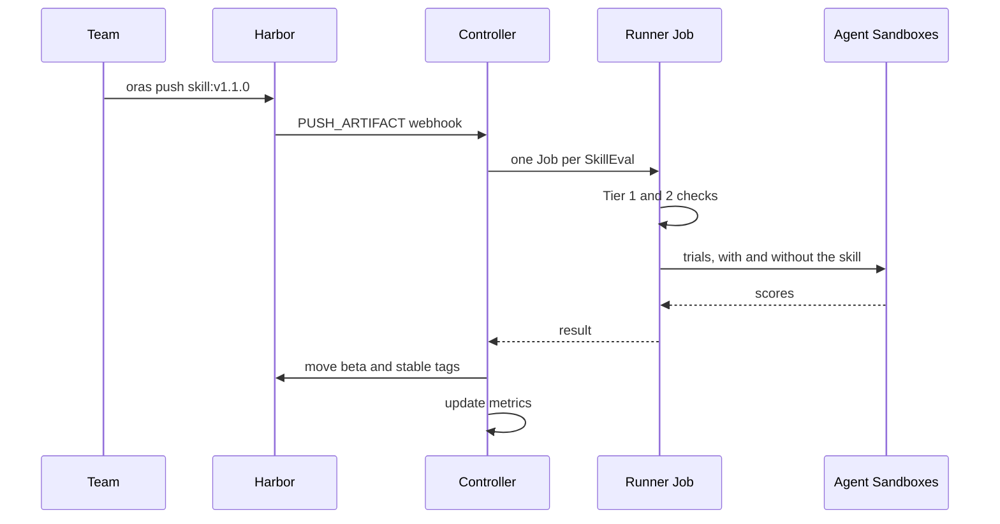
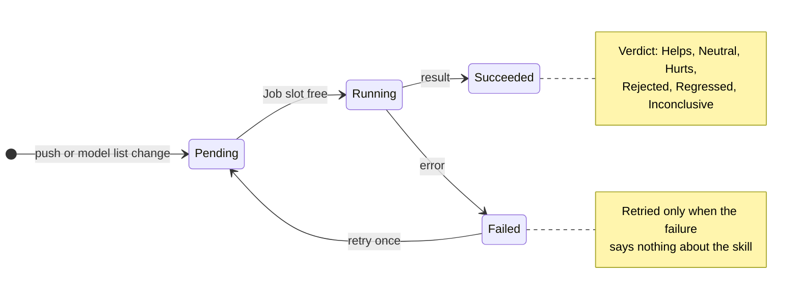

<div class="absolute inset-0 flex flex-col justify-center items-start px-20">
  <div class="event">KubeAuto Day North America 2026 · Salt Lake City · November 9, 2026</div>
  <h1 class="!text-[7.6rem] !leading-[1.02] !font-semibold !tracking-tight !m-0 !max-w-[92%]">
    Skills Are<br />Packages Now.
  </h1>
  <p class="sub">Your platform should treat them that way.</p>
  <div class="speaker" v-click>
    
    <div>
      <div class="speaker__name">Engin Diri</div>
      <div class="speaker__role">Principal Solutions Architect, Pulumi</div>
      <div class="speaker__handles">
        <span><carbon-logo-x /> @_ediri</span>
        <span><carbon-logo-linkedin /> engin-diri</span>
        <span><carbon-logo-github /> dirien</span>
      </div>
    </div>
  </div>
</div>

<style scoped>
.event { font-family: var(--slidev-font-mono); font-size: 0.95rem; font-weight: 700; letter-spacing: 0.04em; text-transform: uppercase; color: var(--p-primary); margin-bottom: 2rem; }
.sub { margin: 1.6rem 0 0 !important; font-size: 2.9rem !important; line-height: 1.2 !important; color: var(--p-fg-muted) !important; max-width: 90% !important; }
.speaker { display: flex; align-items: center; gap: 1.6rem; margin-top: 3.4rem; }
.speaker img { width: 7.5rem; height: 7.5rem; border-radius: 9999px; object-fit: cover; border: 3px solid color-mix(in srgb, var(--p-primary) 45%, transparent); }
.speaker__name { font-size: 1.8rem; font-weight: 600; color: var(--p-fg); }
.speaker__role { font-size: 1.3rem; color: var(--p-fg-muted); margin-top: 0.2rem; }
.speaker__handles { display: flex; gap: 1.6rem; margin-top: 0.6rem; font-size: 1.05rem; color: var(--p-fg-muted); }
.speaker__handles span { display: inline-flex; align-items: center; gap: 0.4rem; }
</style>

<!--
[0:00 to 0:30]

Good afternoon, KubeAuto. I'm Engin, I work at Pulumi on platform tooling.
[click] Quick thank-you to the organizers for putting this day next to
KubeCon. 25 minutes: a problem, a platform answer, a demo, what broke while
I built it, and a blueprint you can take home.

TODO: confirm the session start time and whether Q&A is inside the 25 minutes.
-->

---

<div class="statement">
  <p class="statement__kicker">It's 2026.</p>
  <h1>Skills are <em>big business</em>.</h1>
</div>

<!--
[0:30 to 0:45]

It's 2026 and skills are big business. Look at your own company: it's highly
likely that every team ships agent skills by now.
-->

---

<div class="statement statement--long">
  <ph-hand-waving class="statement__icon" />
  <h1>Hands up if you have a skills <em>repo</em>.</h1>
</div>

<!--
[0:45 to 1:15]

Show of hands. Who has a skills repo, at team level or company level? Keep
them up. Look around, that's most of the room.
-->

---

<div class="statement statement--long">
  <ph-hand-waving class="statement__icon" />
  <h1>Hands up if you re-ran <em>evals</em> when the model changed.</h1>
</div>

<!--
[1:15 to 1:50]

Second one. Keep your hand up if you re-ran evals on those skills the last
time the model changed. Or the agent got a new release.

Count what you see and say it out loud ("about three hands"). That is the
gap this talk is about.
-->

---
layout: full
---

<Meme src="/memes/this-is-fine.jpg" fit="contain" top="Model updated overnight" bottom="My skills: this is fine" :size="5" />

<!--
[1:50 to 2:00]

That's the usual answer. The model changes, the skills stay, and we assume
it's fine.

Template: "This Is Fine" (KC Green), via imgflip.
-->

---

<div class="statement">
  <h1>Every team ships <em>skills</em> by now.</h1>
</div>

<!--
[2:00 to 2:20]

Skills are sprawling. Every team writes its own, in its own repo, with its
own idea of "works". Nobody asks the platform team, because a skill is just
a folder.
-->

---

# A skill is a package

<div class="grid grid-cols-2 gap-10 mt-4 items-center zm">
  <div class="gpu-card gpu-card--primary" v-click>
    <div class="gpu-caption gpu-caption--accent">The folder</div>

```text
acme-release-notes/
├── SKILL.md
└── evals/
    └── evals.json
```

  </div>
  <div class="gpu-card gpu-card--muted" v-click>
    <div class="gpu-caption gpu-caption--muted">It already has</div>
    <ul class="!mt-4 !text-[1.45rem] !leading-relaxed space-y-2">
      <li>A name and a description</li>
      <li>A version and a license</li>
      <li>An author</li>
      <li>Tests, in <code>evals/</code></li>
    </ul>
  </div>
</div>

<!--
[2:20 to 2:50]

Here is a real one from the demo: acme-release-notes. A folder with a
SKILL.md and its evals. Frontmatter carries name, description, license, an
author and a version. That is a package manifest in everything but name.

[click] The folder. [click] And the metadata. Name, version, license, author,
tests. It already looks like a package.

Fact check: skills/acme-release-notes/SKILL.md and evals/evals.json in the
repo; the metadata fields are the frontmatter of that file.
-->

---

<div class="statement">
  <h1>A package declares its <em>dependencies</em>.</h1>
</div>

<!--
[2:50 to 3:00]

And packages declare their dependencies. That's the part skills skip.
-->

---

# A skill has two dependencies nobody declares

<div class="diagram-slide">
  <Diagram name="dependencies" alt="A skill depends on the model and on the agent harness, and neither is declared" />
</div>

<style scoped>
.diagram-slide { height: 33rem; margin-top: 0.4rem; }
</style>

<!--
[3:00 to 3:50]

A skill is written against a model. That is the first dependency. It is also
run by an agent harness, Claude Code, Codex, OpenCode, each with its own
release train. That is the second. Neither shows up in the SKILL.md.

In the demo the harness is pinned: Claude Code 2.1.292, Codex 0.161.0,
OpenCode 1.19.1. A new release of any of them can change how a skill is found
and followed. Same folder, different result.

Source: README.md "Agents and their versions", CONTRACT.md "Agent versions".
Drawn in Excalidraw: slides/diagrams/dependencies.excalidraw.
-->

---

<div class="statement">
  <h1>Skills can make the agent <em>worse</em>.</h1>
</div>

<!--
[3:50 to 4:00]

And the other thing we skip: a skill can make the agent worse. People have
measured it.
-->

---

# The numbers are already out there

<div class="grid grid-cols-3 gap-8 mt-6 zm">
  <div class="gpu-card gpu-card--primary ev" v-click>
    <div class="gpu-caption gpu-caption--accent">SkillsBench</div>
    <div class="ev__big">13 of 87</div>
    <p>tasks got worse with curated skills, while the average rose 16.6 points</p>
    <div class="src">arxiv.org/abs/2602.12670v4</div>
  </div>
  <div class="gpu-card gpu-card--primary ev" v-click>
    <div class="gpu-caption gpu-caption--accent">SWE-Skills-Bench</div>
    <div class="ev__big">92 of 98</div>
    <p>skills had no statistically significant effect</p>
    <div class="src">arxiv.org/abs/2603.15401</div>
  </div>
  <div class="gpu-card gpu-card--primary ev" v-click>
    <div class="gpu-caption gpu-caption--accent">Nick Nisi, WorkOS</div>
    <div class="ev__big">97% → 77%</div>
    <p>success on one task without the skill, then with it</p>
    <div class="src">AI Engineer Europe 2026, youtu.be/vy7o1g2iHY8</div>
  </div>
</div>

<style scoped>
.ev { display: flex; flex-direction: column; gap: 1rem; }
.ev__big { white-space: nowrap; font-size: 3.1rem; font-weight: 600; letter-spacing: -0.04em; line-height: 1; color: var(--p-fg); }
.ev p { margin: 0 !important; font-size: 1.5rem !important; line-height: 1.3 !important; flex: 1; }
</style>

<!--
[4:00 to 5:30]

Three data points, all public.

[click] SkillsBench, the June 2026 version: 87 tasks, 18 model and harness
configurations. Curated skills lift the average pass rate from 33.9 to 50.5
percent, plus 16.6 points, and still 13 of 87 tasks got worse. The worst are
exam-block-sequencing and suricata-custom-exfil at minus 7.4 points. Averages
hide the tasks where the skill hurts. (The February version said 16 of 84
tasks and plus 16.2 points; quote the current one.)

[click] SWE-Skills-Bench: 98 skills, and 92 of them have no statistically
significant effect. The average pass ratio moves from 76.6 to 76.9 percent.
Individual swings reach plus 17.7 and minus 17.0 points.

[click] Nick Nisi from WorkOS, at AI Engineer Europe 2026: one task
succeeded 97 percent of the time without the skill and 77 percent with it. He
then deleted 95 percent of his skills, replaced more than 10,000 generated
lines with 553 lines of hand-written gotchas, and his eval runs went from 68
minutes to 6. This one is a practitioner talk, not a paper.

Sources are on the slide. None of these are statements about your
skills. They say you cannot know without measuring.
-->

---
layout: full
---

<Meme src="/memes/one-does-not-simply.jpg" top="One does not simply" bottom="Ship a skill without testing it" :size="5.4" />

<!--
[5:30 to 5:40]

One does not simply ship a skill without testing it. And yet.

Template: "One Does Not Simply" (Boromir, The Lord of the Rings), via imgflip.
-->

---

<div class="statement">
  <h1>That's a classic <em>platform</em> problem.</h1>
</div>

<!--
[5:40 to 5:55]

Many teams, a shared artifact, a moving dependency, nobody owns the quality.
That is a classic platform problem. And platform teams have solved it before.
-->

---

<div class="statement">
  <h1>Platform teams solved this <em>before</em>.</h1>
</div>

<!--
[5:55 to 6:05]

For containers. For infrastructure. For packages.
-->

---

# The same loop, for skills

<div class="grid grid-cols-3 gap-8 mt-6 zm">
  <div class="gpu-card gpu-card--primary loop" v-click>
    <div class="gpu-caption gpu-caption--accent">Registry</div>
    <p><strong>Containers:</strong> images in an OCI registry</p>
    <p><strong>Skills:</strong> OCI artifacts in the same kind of registry</p>
  </div>
  <div class="gpu-card gpu-card--primary loop" v-click>
    <div class="gpu-caption gpu-caption--accent">Pipeline</div>
    <p><strong>Containers:</strong> build, scan, and test on every push</p>
    <p><strong>Skills:</strong> evaluate on every push and every model change</p>
  </div>
  <div class="gpu-card gpu-card--primary loop" v-click>
    <div class="gpu-caption gpu-caption--accent">Gate</div>
    <p><strong>Containers:</strong> promote the tag when it is green</p>
    <p><strong>Skills:</strong> promote to <code>stable</code> when it helps</p>
  </div>
</div>

<style scoped>
.loop { display: flex; flex-direction: column; gap: 1.2rem; }
.loop p { margin: 0 !important; font-size: 1.5rem !important; line-height: 1.3 !important; }
.loop strong { color: var(--p-primary); }
</style>

<!--
[6:05 to 7:00]

You push an image to a registry. A pipeline builds, scans and tests it. A gate
decides which tag moves to production. Nobody asks a human to eyeball it.

[click] Registry: skills are OCI artifacts, so they go in the same kind of
registry. In the demo that is Harbor.
[click] Pipeline: the test run is an eval, with the skill and without it.
It runs when a version is pushed and when the model or harness changes.
[click] Gate: a version that helps gets the stable tag. One that makes the
agent worse stays back.

Skills differ from images, and the loop still transfers.
-->

---
layout: full
---

<Meme src="/memes/yo-dawg.jpg" top="I heard you like CI" bottom="So we put CI on your skills" :size="5.4" />

<!--
[7:00 to 7:10]

So: I heard you like CI, so we put CI on your skills.

Template: "Yo Dawg" (Xzibit), via imgflip.
-->

---

<div class="statement statement--triple">
  <h1><span v-click>Registry.</span> <span v-click>Pipeline.</span> <span v-click><em>Gate.</em></span></h1>
</div>

<style scoped>
.statement--triple h1 { font-size: 6.6rem !important; white-space: nowrap; max-width: none; }
</style>

<!--
[7:10 to 7:30]

Three parts. [click] Registry. [click] Pipeline. [click] Gate. Here is the
stack I built to try it, on plain Kubernetes.
-->

---

# One push, one controller, many sandboxes

<div class="diagram-slide">
  <Diagram name="architecture" alt="Architecture: a team pushes a skill to Harbor, a webhook triggers the skill-ci controller, which starts a runner Job that runs trials in Agent Sandboxes, then moves tags and exports metrics" />
</div>

<style scoped>
.diagram-slide { height: 36rem; margin-top: -0.5rem; }
</style>

<!--
[7:30 to 9:00]

Walk it left to right.

1. A team pushes a skill with ORAS. It lands in Harbor as an OCI artifact.
2. Harbor fires a PUSH_ARTIFACT webhook at the controller.
3. The controller, a Go service with a SkillEval custom resource, creates one
   SkillEval per entry in the model list, and each one becomes a Job. The
   model list is a ConfigMap. Change it, say a new harness release, and the
   controller evaluates every beta and stable skill again. That is the arrow
   from the top.
4. The Job pulls the skill by digest, runs the Tier 1 and 2 checks, then runs
   trials. Every trial is one Agent Sandbox, for Claude Code with Opus 5.5,
   Codex with gpt-6.1-sol, OpenCode with Qwen 3.8 Flash.
5. Scores come back, the controller applies the policy and moves the tags
   through the Harbor API. Metrics go to Prometheus and Grafana, and there is
   a reporting site for the humans.

Drawn in Excalidraw: slides/diagrams/architecture.excalidraw (edit it at
excalidraw.com, then run npm run diagrams).
-->

---

# The parts and their jobs

<div class="grid grid-cols-4 gap-5 mt-4 parts">
  <div class="gpu-card gpu-card--muted part" v-click><ph-package class="part__icon" /><div class="part__name">Harbor</div><div class="part__job">Skills as OCI artifacts, push webhook</div><div class="part__ver">goharbor 2.15.4</div></div>
  <div class="gpu-card gpu-card--muted part" v-click><ph-arrows-down-up class="part__icon" /><div class="part__name">ORAS</div><div class="part__job">Pushes, pulls, and tags skills</div><div class="part__ver">1.3.0</div></div>
  <div class="gpu-card gpu-card--muted part" v-click><ph-magnifying-glass class="part__icon" /><div class="part__name">SkillEvaluator</div><div class="part__job">Three tiers, with and without lift</div><div class="part__ver">NVIDIA, 0.6.0 + patch</div></div>
  <div class="gpu-card gpu-card--muted part" v-click><ph-flask class="part__icon" /><div class="part__name">Harbor framework</div><div class="part__job">Runs the agent trials</div><div class="part__ver">0.24.0</div></div>
  <div class="gpu-card gpu-card--muted part" v-click><ph-cube class="part__icon" /><div class="part__name">Agent Sandbox</div><div class="part__job">One Sandbox per trial</div><div class="part__ver">kubernetes-sigs, v1.0.9</div></div>
  <div class="gpu-card gpu-card--primary part" v-click><ph-gear-six class="part__icon" /><div class="part__name">skill-ci controller</div><div class="part__job">SkillEval CRD, Jobs, policy, tags</div><div class="part__ver">Go, 0.6.0</div></div>
  <div class="gpu-card gpu-card--muted part" v-click><ph-chart-line-up class="part__icon" /><div class="part__name">Prometheus + Grafana</div><div class="part__job">Lift per skill version</div><div class="part__ver">kube-prometheus-stack</div></div>
  <div class="gpu-card gpu-card--muted part" v-click><ph-browsers class="part__icon" /><div class="part__name">Reporting site</div><div class="part__job">Every run, in plain words</div><div class="part__ver">served by the controller</div></div>
</div>

<style scoped>
.part { display: flex; flex-direction: column; gap: 0.5rem; padding: 1.2rem 1.3rem; }
.part__icon { font-size: 2rem; color: var(--p-primary); }
.part__name { font-size: 1.45rem; font-weight: 700; line-height: 1.15; color: var(--p-fg); }
.part__job { font-size: 1.12rem; line-height: 1.3; color: var(--p-fg); flex: 1; }
.part__ver { font-family: var(--slidev-font-mono); font-size: 0.8rem; color: var(--p-fg-muted); }
</style>

<!--
[9:00 to 10:00]

Eight parts, all open source, all running on one DOKS cluster with
Kubernetes 1.36.5.

[click] Harbor stores skills as OCI artifacts and fires the webhook.
[click] ORAS pushes, pulls and tags them.
[click] NVIDIA's SkillEvaluator does the actual evaluation: three tiers and
live with and without the skill runs. I run 0.6.0 with a small patch.
[click] The Harbor framework runs agent trials.
[click] Agent Sandbox, from kubernetes-sigs, gives each trial its own
Sandbox.
[click] The controller is the part I wrote: the SkillEval CRD, the Jobs, the
policy, the tag moves.
[click] Prometheus and Grafana for the numbers over time.
[click] And a small reporting site served by the controller.

Versions are from README.md in the repo. The Helm chart of the controller and
the Pulumi YAML program are in the same repo.
-->

---

# What happens on a push



<!--
[10:00 to 10:45]

The same flow as a sequence. Two details matter.

The webhook only counts for tags that look like vX.Y.Z. beta and stable are
ignored, so the controller moving a tag never triggers itself. And the
controller dedupes by digest, not by tag.

The Job runs Tier 1 and 2 first. If they fail, the arrow to the sandboxes
never happens.

Source: CONTRACT.md "Triggers", "All tiers and publication".
-->

---

# The life of a SkillEval



<!--
[10:45 to 11:30]

One SkillEval is one custom resource per skill digest and model list entry.
It goes Pending, Running, Succeeded or Failed.

A failure is retried once, but only when it says nothing about the skill: a
pod evicted, a connection lost, an agent install that failed. A run with
scores is never retried, because retrying bad answers until they pass would
bias the score.

A Succeeded run carries a verdict. Helps, Neutral, Hurts, Rejected when Tier 1
or 2 failed, and the two version-over-version verdicts we get to in a minute,
Regressed and Inconclusive.

Source: CONTRACT.md "CRD: SkillEval", "Retry".
The verdict is a status field of a Succeeded run, not a phase of its own.
-->

---

<div class="statement">
  <h1>Cheap checks <em>first</em>.</h1>
</div>

<!--
[11:30 to 11:40]

Evals cost tokens, so the pipeline starts with the cheap checks.
-->

---

# Three tiers, one gate

<div class="grid grid-cols-3 gap-8 mt-6 zm">
  <div class="gpu-card gpu-card--primary tier" v-click>
    <div class="gpu-caption gpu-caption--accent">Tier 1</div>
    <div class="tier__title">Static, security, quality</div>
    <p>Schema, security scan, PII, license, lint</p>
    <div class="tier__cost">No tokens</div>
  </div>
  <div class="gpu-card gpu-card--primary tier" v-click>
    <div class="gpu-caption gpu-caption--accent">Tier 2</div>
    <div class="tier__title">Deduplication</div>
    <p>Against the other skills in the registry</p>
    <div class="tier__cost">No agent runs</div>
  </div>
  <div class="gpu-card gpu-card--accent tier" v-click>
    <div class="gpu-caption gpu-caption--accent">Tier 3</div>
    <div class="tier__title">Live evaluation</div>
    <p>With and without the skill, in sandboxes</p>
    <div class="tier__cost">Spends tokens</div>
  </div>
</div>

<div class="info-card zm" v-click>
  <div class="info-card__label">Fails Tier 1 or 2</div>
  <p>Verdict <strong>Rejected</strong>. Tier 3 never runs: no sandboxes, no tokens.</p>
</div>

<style scoped>
.tier { display: flex; flex-direction: column; gap: 0.9rem; }
.tier__title { font-size: 1.9rem; font-weight: 600; letter-spacing: -0.03em; line-height: 1.1; color: var(--p-fg); }
.tier p { margin: 0 !important; font-size: 1.4rem !important; line-height: 1.3 !important; flex: 1; }
.tier__cost { font-family: var(--slidev-font-mono); font-size: 1rem; font-weight: 700; color: var(--p-primary); text-transform: uppercase; letter-spacing: 0.06em; }
</style>

<!--
[11:40 to 12:40]

SkillEvaluator has three tiers.

[click] Tier 1 is static: schema, security, PII, license, code integrity,
unicode, version, quality, lint. The security scan is where a skill that
pipes curl into sudo bash dies.
[click] Tier 2 compares the skill against the others in the registry for
duplicates. It needs an embeddings provider.
[click] Tier 3 is the live run, with and without the skill.

[click] If Tier 1 or 2 fail, the runner skips Tier 3 completely. The verdict is
Rejected, no sandbox starts, no tokens are spent. A digest with a Rejected run
on a required model never gets beta or stable.

Source: CONTRACT.md "All tiers and publication"; README.md "Tiers and
scanners in the runner".
-->

---

# The lift: with the skill, and without

<div class="lift mt-6">
  <div class="lift__row" v-for="m in [
    { agent: 'Claude Code 2.1.292', name: 'claude-opus-5-5', without: 0.36, withSkill: 0.95, lift: '+0.59', ci: '[+0.58, +0.60]' },
    { agent: 'Codex 0.161.0', name: 'gpt-6.1-sol', without: 0.47, withSkill: 0.72, lift: '+0.25', ci: '[+0.24, +0.27]' },
    { agent: 'OpenCode 1.19.1', name: 'qwen3.8-flash', without: 0.39, withSkill: 0.96, lift: '+0.57', ci: '[+0.55, +0.58]' },
  ]" :key="m.name" v-click>
    <div class="lift__name"><div class="lift__agent">{{ m.agent }}</div>{{ m.name }}</div>
    <div class="lift__bars">
      <div class="lift__bar lift__bar--without" :style="{ width: m.without * 100 + '%' }"><span>without {{ m.without.toFixed(2) }}</span></div>
      <div class="lift__bar lift__bar--with" :style="{ width: m.withSkill * 100 + '%' }"><span>with {{ m.withSkill.toFixed(2) }}</span></div>
    </div>
    <div class="lift__val">{{ m.lift }}<div class="lift__ci">95% CI {{ m.ci }}</div></div>
  </div>
</div>
<div class="src mt-6">acme-release-notes v1.0.0, 3 eval cases × 3 attempts per arm (9 trials each). Recorded 2026-10-31.</div>

<style scoped>
.lift { display: flex; flex-direction: column; gap: 1.6rem; }
.lift__row { display: grid; grid-template-columns: 13rem 1fr 12rem; align-items: center; gap: 1.5rem; }
.lift__name { font-family: var(--slidev-font-mono); font-size: 1.05rem; color: var(--p-fg-muted); }
.lift__agent { font-family: var(--slidev-font-sans); font-size: 1.15rem; font-weight: 600; color: var(--p-fg); }
.lift__ci { white-space: nowrap; font-family: var(--slidev-font-mono); font-size: 0.85rem; font-weight: 400; letter-spacing: 0; color: var(--p-fg-muted); }
.lift__bars { display: flex; flex-direction: column; gap: 0.5rem; }
.lift__bar { height: 2.1rem; border-radius: 6px; display: flex; align-items: center; padding-left: 0.8rem; font-family: var(--slidev-font-mono); font-size: 0.95rem; white-space: nowrap; }
.lift__bar--without { background: var(--p-border); color: var(--p-fg); }
.lift__bar--with { background: var(--p-primary); color: var(--p-bg); font-weight: 700; }
.lift__val { font-size: 2.4rem; font-weight: 600; letter-spacing: -0.04em; color: var(--p-primary); text-align: right; }
</style>

<!--
[12:40 to 13:40]

This is the core measurement. Same skill, acme-release-notes, which teaches a
made-up release note format called ACME-RN/2. Three agents, each with its own
model. Claude Code with Opus 5.5 goes from 0.36 to 0.95, plus 0.59. Codex with
gpt-6.1-sol goes from 0.47 to 0.72, plus 0.25. OpenCode with Qwen 3.8 Flash
through OpenRouter, a small and cheap model, goes from 0.39 to 0.96, plus 0.57.
All three intervals sit well above zero: nine trials per arm, and the scores
barely move between trials.

The same skill helps all three, by very different amounts, and the small model
with the skill matches the big one. That is why the lift is measured per agent
and model, never once for the skill.

I picked the format on purpose. No model can know it, so the lift is large and
easy to read. Real skills have smaller lifts, and sometimes none. Be upfront
about that.

Numbers: SkillEvals on the DOKS cluster, completed 2026-10-31
(release 0.7.1: claude-code 2.1.292 with claude-opus-5-5, codex 0.161.0 with
openai/gpt-6.1-sol; opencode 1.19.1 with openrouter/qwen/qwen3.8-flash on
release 0.7.2), 3 cases × 3 attempts per arm.
-->

---

<div class="statement">
  <h1>One number is a bad <em>gate</em>.</h1>
  <p>The same version scored 0.95, then 0.87.</p>
</div>

<!--
[13:40 to 14:10]

My first gate was a fixed number: more than 0.05 below stable is a
regression. The same skill version scored 0.95 on one run and 0.87 on the
next, and that gate held a good version back.

An LLM eval is a noisy measurement. A gate on one number fires on noise.

Source: README.md "How the gate decides".
-->

---

# The gate asks for evidence

<div class="grid grid-cols-[1.75fr_1fr] gap-8 mt-4 items-center">
  <div v-click>
    <IntervalChart />
  </div>
  <div class="rules">
    <div class="gpu-card gpu-card--muted" v-click>
      <div class="gpu-caption gpu-caption--muted">9 trials per arm</div>
      <p>3 eval cases × 3 attempts, Welch interval at 95%</p>
    </div>
    <div class="gpu-card gpu-card--primary" v-click>
      <div class="gpu-caption gpu-caption--accent">Whole interval below 0</div>
      <p><strong>Regressed</strong>: fix the skill</p>
    </div>
    <div class="gpu-card gpu-card--accent" v-click>
      <div class="gpu-caption gpu-caption--accent">Interval includes 0</div>
      <p><strong>Inconclusive</strong>: run more trials</p>
    </div>
  </div>
</div>

<style scoped>
.rules { display: flex; flex-direction: column; gap: 1rem; }
.rules p { margin: 0.7rem 0 0 !important; font-size: 1.3rem !important; line-height: 1.3 !important; }
.rules strong { color: var(--p-primary); }
</style>

<!--
[14:10 to 15:20]

Each run keeps its trial scores: three eval cases, three attempts each, up to
nine scores per arm. The controller puts a Welch confidence interval, 95
percent by default, around the difference between the candidate and the
stable version.

[click] Chart: the difference to stable, from minus 0.40 to plus 0.10. The
dashed line is the 0.05 tolerance.
[click] Nine trials per arm.
[click] Top row: the measured v1.2.0 run on Claude Code, difference minus 0.29,
interval from minus 0.31 to minus 0.27. The whole interval is below zero. The
drop is real: Regressed.
[click] Bottom row: difference minus 0.08, interval from minus 0.18 to plus
0.03. It is bigger than the tolerance, but noise could explain it:
Inconclusive. Not promoted, stable stays, and the message to the author is
"run more trials" instead of "fix it".

The same rule guards promotion: a lift of plus 0.12 whose interval runs from
minus 0.05 to plus 0.29 does not earn stable.

The top row is measured (SkillEvals on the DOKS cluster, 2026-10-31, 9 trials
per arm). The bottom row is the worked example in CONTRACT.md and README.md
("Policy"), from the unit-test fixtures of the controller: no run on the
current model list was Inconclusive. Say so if asked.
-->

---

# Tags are the release channels

<div class="grid grid-cols-[1.25fr_1fr] gap-10 mt-4 items-center">
  <div class="chan">
    <div class="chan__row" v-click>
      <span class="chan__ver">v1.0.0</span><span class="chan__tag chan__tag--none">superseded</span>
    </div>
    <div class="chan__row" v-click>
      <span class="chan__ver">v1.1.0</span><span class="chan__tag chan__tag--stable">stable</span>
    </div>
    <div class="chan__row" v-click>
      <span class="chan__ver">v1.2.0</span><span class="chan__tag chan__tag--beta">beta</span><span class="chan__note">Regressed, held back</span>
    </div>
    <div class="src mt-4">acme-release-notes, tags as set by the controller</div>
  </div>
  <div>
    <v-clicks>
    <ul class="!text-[1.35rem] !leading-snug space-y-3 rules">
      <li>Newest evaluated version gets <code>beta</code></li>
      <li>Lift ≥ +0.10 on every required model, interval above 0: <code>stable</code></li>
      <li>Worse than stable beyond noise: stays at <code>beta</code></li>
      <li>Fails Tier 1 or 2: no <code>beta</code></li>
    </ul>
    </v-clicks>
  </div>
</div>

<style scoped>
.chan { display: flex; flex-direction: column; gap: 1.1rem; }
.chan__row { display: flex; align-items: center; gap: 1.3rem; padding: 1rem 1.4rem; border: 1.5px solid var(--p-border); border-radius: 14px; background: var(--p-bg-elevated); }
.chan__ver { font-family: var(--slidev-font-mono); font-size: 1.9rem; font-weight: 700; color: var(--p-fg); }
.chan__tag { font-family: var(--slidev-font-mono); font-size: 1.1rem; font-weight: 700; padding: 0.25rem 0.8rem; border-radius: 999px; }
.chan__tag--stable { background: var(--p-primary); color: var(--p-bg); }
.chan__tag--beta { border: 2px solid var(--p-primary); color: var(--p-primary); }
.chan__tag--none { color: var(--p-fg-muted); border: 2px dashed var(--p-border); }
.chan__note { font-size: 1.1rem; color: var(--p-fg-muted); }
</style>

<!--
[15:20 to 16:10]

The tags beta and stable are the release channels. Nobody types them. The
controller moves them through the Harbor API.

[click] v1.0.0 was fine, and superseded.
[click] v1.1.0 adds two rules and scores as well as v1.0.0, so it took over
stable.
[click] v1.2.0 is the regression. It stays at beta, because the newest
evaluated version always gets beta, but it never gets stable.

The rules on the right. Beta goes to the newest evaluated version. Stable needs
a lift of at least plus 0.10 on every required model with the interval above
zero, and no regression against the current stable. Optional models run and
get reported, but never gate. Tier 1 or 2 failure keeps a version out of both
channels.

Tags from README.md "Sample skills" and DEMO.md "Expected tags in Harbor".
-->

---

<div class="statement">
  <h1>Let's push some <em>skills</em>.</h1>
</div>

<!--
[16:10 to 16:20]

Let's watch it work. I pre-baked the results, because one SkillEval takes 11
to 13 minutes. I'll trigger one live push so you see it start.

TODO: decide before the talk whether to trigger a live push (spends tokens and
three Job slots, result arrives after the talk) or show only the finished
objects. DEMO.md has both options for beat 2.
-->

---

# Demo 1: push a skill

<div class="demo">

```bash
make status
make demo-push SKILL=acme-release-notes VERSION=v1.1.0
kubectl -n skill-ci get skillevals -w
```

<div class="info-card" v-click>
  <div class="info-card__label">What you see</div>
  <ul>
    <li>Harbor fires the webhook, the controller logs it</li>
    <li>One SkillEval per model list entry: Pending, then Running</li>
    <li>The skills in Harbor with their tags</li>
  </ul>
</div>

</div>

<!--
[16:20 to 17:10]

make status shows two blocks: the SkillEvals, and the skills in Harbor with
their digests and tags. These are OCI artifacts, pushed with the artifact type
application/vnd.agentskill.v1.

Then the push. In the controller log you see the webhook handled, then new
SkillEvals appear Pending, then Running as Jobs start. One per entry of the
model list, for this digest.

Do not wait: "that takes twelve minutes, here is one I prepared earlier."

Source: DEMO.md beats 1 and 2, README.md "Run the demo". The push path ran
with the current model list on 2026-10-31 (make demo-push, three entries,
about 12 minutes per round). Rehearse the live push of a copied directory once
more before the talk.
-->

---

# Demo 2: the gate says no, before any tokens

<div class="demo">

```bash
make demo-push SKILL=k8s-resource-naming VERSION=v1.1.0
kubectl -n skill-ci get skillevals \
  -l skillci.dev/skill=k8s-resource-naming -o wide
```

<div class="info-card" v-click>
  <div class="info-card__label">Tier 1, security check</div>
  <p><code>curl … | sudo bash</code> in <code>scripts/bootstrap.sh</code>. Verdict <strong>Rejected</strong>, Tier 3 skipped.</p>
</div>

</div>

<!--
[17:10 to 18:10]

k8s-resource-naming v1.1.0 is deliberately unsafe. It is v1.0.0 plus a cluster
bootstrap section that tells the agent to run a script, and the script pipes a
remote installer into a root shell. The host is a reserved .example name and
nothing runs it.

Tier 1's security check flags two high findings: External Script Fetching and
Chaining Abuse, both at scripts/bootstrap.sh line 5. The runner reports Tier 1
failed, skips Tier 3, and the controller marks the run Rejected. No sandboxes,
no tokens. v1.0.0 of the same skill passes the same check.

Source: demo/variants/README.md. Ran on 2026-10-31 with all three entries:
each one Rejected with Tier1Failed, the same two findings, no trials.
Fallback: the backup slide "the Rejected run" after the closing slide.
-->

---

# Demo 3: the regression is held back

<div class="reg mt-4">
  <div class="reg__head"><span>Agent and model</span><span>Stable v1.1.0</span><span>v1.2.0</span><span>Lift</span><span>Verdict</span></div>
  <div class="reg__row" v-click><span>Claude Code · opus-5-5</span><span>0.98</span><span class="reg__bad">0.69</span><span>+0.33</span><span class="reg__bad">Regressed</span></div>
  <div class="reg__row" v-click><span>Codex · gpt-6.1-sol (optional)</span><span>0.72</span><span>0.47</span><span>+0.01</span><span>Neutral</span></div>
  <div class="reg__row" v-click><span>OpenCode · qwen3.8-flash (optional)</span><span>0.95</span><span>0.72</span><span>+0.35</span><span>Helps</span></div>
</div>

<div class="demo">

```bash
kubectl -n skill-ci get skillevals -o wide \
  -l skillci.dev/skill=acme-release-notes | grep v1-2-0
```

</div>

<style scoped>
.reg { display: flex; flex-direction: column; gap: 0.7rem; margin-bottom: 1.6rem; }
.reg__head, .reg__row { display: grid; grid-template-columns: 2.4fr 1fr 0.8fr 0.8fr 1fr; gap: 1rem; align-items: center; padding: 0.7rem 1.2rem; font-size: 1.35rem; }
.reg__head { font-family: var(--slidev-font-mono); font-size: 0.95rem; font-weight: 700; text-transform: uppercase; letter-spacing: 0.06em; color: var(--p-fg-muted); padding-bottom: 0; }
.reg__row { border: 1.5px solid var(--p-border); border-radius: 12px; background: var(--p-bg-elevated); }
.reg__row span:first-child { font-family: var(--slidev-font-mono); font-size: 1.1rem; }
.reg__bad { color: #bd141c; font-weight: 700; }
:global(.dark) .reg__bad { color: #ff9fa4; }
</style>

<!--
[18:10 to 19:40]

This is the best moment of the talk. v1.2.0 of acme-release-notes is a
deliberately worse rewrite whose rules contradict its own evals.

Look at the lift on Claude Code: plus 0.33. A check against the no-skill
baseline alone says this skill helps, and would have promoted it. But stable
v1.1.0 scored 0.98 with the skill, and this version scores 0.69. The gate
compares with the version you run today: a difference of minus 0.29, 95%
interval minus 0.31 to minus 0.27, all of it below the tolerance. Regressed,
and v1.2.0 stays at beta.

[click] [click] [click] Point at the two optional rows. Codex drops to 0.47,
Neutral, and OpenCode to 0.72, still Helps over no skill. Both are optional, so
neither gates: that is the policy working as written, not a missed
regression. Say it before someone asks.

Be honest: v1.2.0 was written to fail. The real-world version is a well-meant
edit that fixes one case and breaks two.

Source: DEMO.md "The state the beats rely on" and beat 5; SkillEvals on the
DOKS cluster, 2026-10-31, 9 trials per arm.
-->

---

# Demo 4: the model or the harness changed

<div class="grid grid-cols-3 gap-6 mt-4 zm">
  <div class="gpu-card gpu-card--primary hn" v-click>
    <div class="gpu-caption gpu-caption--accent">Gates promotion</div>
    <div class="hn__agent">Claude Code</div>
    <div class="hn__model">Opus 5.5</div>
    <div class="hn__ver">2.1.292</div>
  </div>
  <div class="gpu-card gpu-card--muted hn" v-click>
    <div class="gpu-caption gpu-caption--muted">Optional</div>
    <div class="hn__agent">Codex</div>
    <div class="hn__model">gpt-6.1-sol</div>
    <div class="hn__ver">0.161.0</div>
  </div>
  <div class="gpu-card gpu-card--muted hn" v-click>
    <div class="gpu-caption gpu-caption--muted">Optional</div>
    <div class="hn__agent">OpenCode</div>
    <div class="hn__model">Qwen 3.8 Flash</div>
    <div class="hn__ver">1.19.1</div>
  </div>
</div>

<div class="demo mt-8">

```bash
make demo-model-swap MODE=bump TO=2.1.308
make demo-model-swap MODE=require AGENT=codex
```

</div>

<style scoped>
.hn { display: flex; flex-direction: column; gap: 0.6rem; }
.hn__agent { font-size: 2.2rem; font-weight: 600; letter-spacing: -0.04em; color: var(--p-fg); margin-top: 0.4rem; }
.hn__model { font-size: 1.6rem; color: var(--p-primary); font-weight: 600; }
.hn__ver { font-family: var(--slidev-font-mono); font-size: 1rem; color: var(--p-fg-muted); }
</style>

<!--
[19:40 to 21:20]

The model list names the harness as well as the model. An entry is agent plus
agent version plus model. Here: Claude Code 2.1.292 with Opus 5.5, which gates
promotion. Codex 0.161.0 with gpt-6.1-sol and OpenCode 1.19.1 with Qwen 3.8
Flash, both optional: they run and show up everywhere but never hold a skill
back.

[click through the three entries]

First command: bump Claude Code to a newer release. A new agent version is a
new entry, so the controller creates a SkillEval for every beta and stable
skill digest on it. Nobody pushed a skill. The tool changed, and every skill in
a release channel is tested against it, the way a package is rebuilt against a
new compiler. Results stay per entry, and the regression gate compares with
stable on the same harness release only.

Second command: flip Codex to required. The runs that already exist are
re-judged at once, with no new run. A skill that Codex does not lift stops
being promoted.

Every run takes 11 to 13 minutes: start it, say "one I prepared earlier",
show finished entries on the reporting site (one column per agent@version and
model) or in Grafana (the agent_version label).

Source: demo/models.yaml, DEMO.md beats 7 and 8, README.md "Agents and their
versions". The judge is always Anthropic, whatever agent runs.

Codex and OpenCode ran end to end on 2026-10-31 (every sample skill and
variant). The harness bump ran live on 2026-10-31 with 2.1.300: four new runs,
v1.2.0 Regressed again against stable on the same harness release
(difference minus 0.28, interval minus 0.31 to minus 0.26). DEMO.md beat 7.
-->

---

# Demo 5: the numbers over time

<div class="demo">

```bash
make dashboard      # Grafana, dashboard skill-ci
make reports-ui     # the reporting site, localhost:8082
make report SKILL=acme-release-notes VERSION=v1.1.0
```

<div class="info-card" v-click>
  <div class="info-card__label">What you see</div>
  <ul>
    <li>Lift per skill version, <code>agent@version</code> and model</li>
    <li>Why v1.2.0 is held back, in plain words</li>
    <li>The full evaluation report, attached to the skill digest</li>
  </ul>
</div>

</div>

<!--
[21:20 to 22:00]

Grafana: the controller exposes skillci_lift, skillci_stable,
skillci_regressed and friends, Prometheus scrapes them. Then the reporting
site: every run, the release channels, and a skill page that says in words why
v1.2.0 is held back and v1.1.0 is on stable.

make report pulls the SkillEvaluator report that is attached to the skill
digest as an OCI referrer. It survives the pod and travels with the artifact.

Source: DEMO.md beat 9. Only v1.1.0 has reports stored in Harbor for the
pre-baked state; do not run make report on v1.0.0 or v1.2.0.

Fallbacks: the backup slides after the closing slide (Grafana, the
acme-release-notes skill page), recorded 2026-10-31.
-->

---

<div class="statement">
  <h1>What broke while I <em>built it</em>.</h1>
</div>

<!--
[22:00 to 22:10]

Building this was not smooth. Six things I would tell my past self.
-->

---

# Lessons from building it, part 1

<div class="grid grid-cols-3 gap-6 mt-4 zm">
  <div class="gpu-card gpu-card--primary les" v-click>
    <ph-ghost class="les__icon" />
    <div class="les__title">Orphaned sandboxes</div>
    <p>Cancelled runs left Agent Sandboxes behind, holding capacity. Sandboxes are now owned by the runner pod.</p>
  </div>
  <div class="gpu-card gpu-card--primary les" v-click>
    <ph-arrows-in-line-vertical class="les__icon" />
    <div class="les__title">The autoscaler evicts</div>
    <p>A scale-down drained the node in the middle of a build. Evals and platform pods opt out of eviction.</p>
  </div>
  <div class="gpu-card gpu-card--primary les" v-click>
    <ph-dice-five class="les__icon" />
    <div class="les__title">One attempt is noise</div>
    <p>0.95 on one run, 0.87 on the next. Three attempts per arm and an interval decide now.</p>
  </div>
</div>

<style scoped>
.les { display: flex; flex-direction: column; gap: 0.8rem; }
.les__icon { font-size: 2.4rem; color: var(--p-primary); }
.les__title { font-size: 1.8rem; font-weight: 600; letter-spacing: -0.03em; line-height: 1.1; color: var(--p-fg); }
.les p { margin: 0 !important; font-size: 1.3rem !important; line-height: 1.35 !important; }
</style>

<!--
[22:10 to 23:00]

[click] Orphaned sandboxes. Cancelled runs left their Agent Sandboxes behind,
and they kept holding cluster capacity until new trials timed out. Sandboxes
created from inside the cluster are now owned by the runner pod, so Kubernetes
garbage-collects them, and the reset target deletes leftovers.

[click] The autoscaler. It drained the node BuildKit ran on in the middle of
an image build. BuildKit, the toolbox and every Harbor component are now
safe-to-evict false, and so are the runner and trial sandbox pods, so a node
scale-down never kills a running eval. If a pod is lost anyway, the run is
retried once, because that says nothing about the skill.

[click] One attempt is noise. A single attempt per arm flipped verdicts. The
deployed default is three attempts per arm and the Welch interval.

Source: git history of dirien/skill-ci (28b017a, 6ae593c, 119a95f, fb8387b),
CONTRACT.md lines on safe-to-evict and Retry.
-->

---

# Lessons from building it, part 2

<div class="grid grid-cols-3 gap-6 mt-4 zm">
  <div class="gpu-card gpu-card--primary les" v-click>
    <ph-arrows-clockwise class="les__icon" />
    <div class="les__title">The stable tag flapped</div>
    <p>An older version took stable from a newer one, and back. Now the newest wins ties, and dedupe is by digest.</p>
  </div>
  <div class="gpu-card gpu-card--primary les" v-click>
    <ph-plug class="les__icon" />
    <div class="les__title">Harbor's Kubernetes backend is thin</div>
    <p>In DinD mode every <code>COPY</code> failed. Each trial runs as an unprivileged Sandbox instead.</p>
  </div>
  <div class="gpu-card gpu-card--primary les" v-click>
    <ph-seal-warning class="les__icon" />
    <div class="les__title">Publication needs all tiers</div>
    <p>Without its scanners, Tier 1 reports incomplete. Tier 2 needs an embeddings key.</p>
  </div>
</div>

<style scoped>
.les { display: flex; flex-direction: column; gap: 0.8rem; }
.les__icon { font-size: 2.4rem; color: var(--p-primary); }
.les__title { font-size: 1.8rem; font-weight: 600; letter-spacing: -0.03em; line-height: 1.1; color: var(--p-fg); }
.les p { margin: 0 !important; font-size: 1.3rem !important; line-height: 1.35 !important; }
</style>

<!--
[23:00 to 23:50]

[click] The stable tag flapped. With controller 0.2.0 an older version that
qualified for promotion took stable from a newer one, and the newer one took
it back: ten tag operations in 18 seconds after a restart. The fix is that
the newest version wins ties unless it scores worse, and the controller
re-checks sibling versions when a result arrives.

[click] Harbor's generic Kubernetes backend is thin. In DinD mode it ships
only the Dockerfile to the build Job, so every COPY fails; its context archive
drops empty directories, which breaks the no-skill baseline; it has no
network or resource policy. I wrote harbor-agent-sandbox to fix the build
context and swap the privileged pod for an unprivileged Sandbox.

[click] Publication is incomplete until all tiers ran. Tier 1 is only
trustworthy with its scanners installed, so the runner image pins them. Tier 2
needs an embeddings provider and Anthropic has none, so you need another
key, or Tier 2 reports incomplete.

Source: DEMO.md "Controller version check", README.md "Findings that shape
the build" and "Tiers and scanners in the runner".
-->

---
layout: full
---

<Meme src="/memes/success-kid.jpg" fit="contain" top="Regression pushed on Friday" bottom="Gate held it at beta" :size="5.2" />

<!--
[23:50 to 24:00]

Which is what you want on a Friday.

Template: "Success Kid", via imgflip.
-->

---

# Your blueprint

<ol class="bp zm">
  <v-clicks>
  <li><span class="bp__n">1</span>Skills are OCI artifacts in a registry</li>
  <li><span class="bp__n">2</span>A push webhook and the model list start the evals</li>
  <li><span class="bp__n">3</span>Static and security checks run before any tokens</li>
  <li><span class="bp__n">4</span>With and without the skill, several attempts, an interval</li>
  <li><span class="bp__n">5</span>Tags are the channels, metrics are the dashboard</li>
  </v-clicks>
</ol>

<style scoped>
.bp { list-style: none; padding: 0; margin: 1.2rem 0 0; display: flex; flex-direction: column; gap: 1.1rem; }
.bp li { display: flex; align-items: center; gap: 1.4rem; font-size: 2rem !important; line-height: 1.2 !important; letter-spacing: -0.02em; margin: 0; }
.bp__n { flex-shrink: 0; width: 3.2rem; height: 3.2rem; border-radius: 9999px; background: var(--p-primary); color: var(--p-bg); display: inline-flex; align-items: center; justify-content: center; font-weight: 700; font-size: 1.5rem; }
</style>

<!--
[24:00 to 24:25]

Five things to take home. The skills live in a registry as OCI artifacts. A
push webhook and the model list, including harness versions, start the evals.
The cheap static and security checks run before any tokens. The live run
compares with and without the skill, with several attempts and a confidence
interval. And the tags are your release channels while metrics are your
dashboard.

Nothing here is specific to my stack. Swap Harbor for the registry you run,
swap the evaluator, keep the loop.
-->

---

# Run it yourself

<div class="grid grid-cols-[1fr_1fr_auto] gap-8 mt-6 items-stretch zm">
  <div class="gpu-card gpu-card--primary way" v-click>
    <ph-rocket-launch class="way__icon" />
    <div class="way__title">With Pulumi</div>
    <p><code>make up</code> creates DOKS, Harbor, Agent Sandbox, and monitoring from a Pulumi YAML program</p>
  </div>
  <div class="gpu-card gpu-card--primary way" v-click>
    <ph-sailboat class="way__icon" />
    <div class="way__title">With plain Helm</div>
    <p>The controller is a Helm chart, <code>charts/skill-ci-controller</code>, on any cluster that has Harbor</p>
  </div>
  <div class="qrcard" v-click>
    <QRCode data="https://github.com/dirien/skill-ci" dark="#000000" />
    <div class="qrcard__label"><carbon-logo-github /> dirien/skill-ci</div>
  </div>
</div>

<style scoped>
.way { display: flex; flex-direction: column; gap: 0.8rem; }
.way__icon { font-size: 2.6rem; color: var(--p-primary); }
.way__title { font-size: 2rem; font-weight: 600; letter-spacing: -0.03em; color: var(--p-fg); }
.way p { margin: 0 !important; font-size: 1.35rem !important; line-height: 1.35 !important; }
.qrcard { display: flex; flex-direction: column; align-items: center; justify-content: center; gap: 0.7rem; }
.qrcard .qr-code { width: 11.5rem; height: 11.5rem; background: #ffffff; padding: 0.55rem; border-radius: 10px; box-shadow: 0 10px 24px rgba(0, 0, 0, 0.18); }
.qrcard__label { display: inline-flex; align-items: center; gap: 0.4rem; font-family: var(--slidev-font-mono); font-size: 1rem; color: var(--p-fg-muted); }
</style>

<!--
[24:25 to 24:45]

Everything is in github.com/dirien/skill-ci: the Pulumi YAML program under
infra, the Helm chart, the controller, the runner, the sample skills and the
demo runbook. The three skills are demo material written for this talk, not
production skills.

[click] With Pulumi: make up builds the cluster, Harbor, secrets, Agent
Sandbox, and Prometheus with Grafana; make deploy installs a release from
GHCR. [click] With plain Helm you only
need the chart, and a Harbor you already run. [click] QR code for the repo.

Source: README.md "Layout", "Helm chart", "Run the demo".
Releases are tagged (v0.7.3 on 2026-10-31) and the GHCR images and chart are
public. TODO: make the GitHub repo public before the talk.
-->

---

<div class="absolute inset-0 flex flex-col justify-center items-center px-16">
  <div class="thanks__kicker">Thank you</div>
  <h1 class="!text-[5.4rem] !leading-[1.02] !font-semibold !tracking-tight !mt-3 !mb-12 text-center">Skills are packages now.</h1>
  <div class="thanks">
    <div class="thanks__person">
      
      <div class="thanks__name">Engin Diri</div>
      <div class="thanks__org">Pulumi</div>
      <div class="thanks__handles">
        <span><carbon-logo-x />@_ediri</span>
        <span><carbon-logo-github />dirien</span>
      </div>
      <div class="thanks__qr"><QRCode data="https://www.linkedin.com/in/engin-diri/" dark="#000000" /></div>
      <div class="thanks__qr-label"><carbon-logo-linkedin />engin-diri</div>
    </div>
    <div class="thanks__person">
      <div class="thanks__avatar thanks__avatar--icon"><carbon-logo-github /></div>
      <div class="thanks__name">skill-ci</div>
      <div class="thanks__org">controller, runner, chart, demo</div>
      <div class="thanks__handles">
        <span>dirien/skill-ci</span>
      </div>
      <div class="thanks__qr"><QRCode data="https://github.com/dirien/skill-ci" dark="#000000" /></div>
      <div class="thanks__qr-label"><carbon-logo-github />dirien/skill-ci</div>
    </div>
  </div>
</div>

<style scoped>
.thanks__kicker { font-family: var(--slidev-font-mono); font-size: 1.15rem; font-weight: 700; letter-spacing: 0.6em; text-transform: uppercase; color: var(--p-fg-muted); }
.thanks { display: grid; grid-template-columns: repeat(2, 1fr); gap: 8rem; justify-items: center; }
.thanks__person { display: flex; flex-direction: column; align-items: center; text-align: center; height: 100%; }
.thanks__avatar { width: 8rem; height: 8rem; border-radius: 9999px; object-fit: cover; border: 3px solid color-mix(in srgb, var(--p-primary) 45%, transparent); }
.thanks__avatar--icon { display: flex; align-items: center; justify-content: center; font-size: 4rem; color: var(--p-fg); background: var(--p-bg-elevated); }
.thanks__name { margin-top: 0.9rem; font-size: 1.7rem; font-weight: 700; color: var(--p-fg); }
.thanks__org { font-size: 1.2rem; color: var(--p-fg-muted); }
.thanks__handles { display: flex; flex-direction: column; align-items: center; justify-content: flex-start; gap: 0.15rem; margin-top: 0.5rem; min-height: 3rem; font-size: 1.1rem; color: var(--p-fg-muted); }
.thanks__handles span { display: inline-flex; align-items: center; gap: 0.35rem; }
.thanks__qr { width: 10rem; height: 10rem; margin-top: 1.1rem; padding: 0.5rem; background: #ffffff; border-radius: 10px; box-shadow: 0 10px 24px rgba(0, 0, 0, 0.18); }
.thanks__qr-label { display: inline-flex; align-items: center; gap: 0.35rem; margin-top: 0.55rem; font-family: var(--slidev-font-mono); font-size: 0.95rem; color: var(--p-fg-muted); }
</style>

<!--
[24:45 to 25:00]

Skills are packages now. Treat them that way: a registry, a pipeline, and a
gate. Thank you, KubeAuto. The QR codes stay up for questions and for the
repo.

TODO: add the session feedback QR if KubeAuto Day provides one.
-->

---

# Backup: the Grafana dashboard


<style scoped>
.fallback { max-height: 30rem; max-width: 100%; margin: 1.5rem auto 0; border-radius: 10px; border: 1.5px solid var(--p-border); }
</style>

<!--
Backup after the closing slide, outside the talk. Show it when Grafana is
unreachable: press the right arrow after the thank-you slide, or jump by number. Screenshot of the DOKS cluster on 2026-10-31
(release 0.7.3, every run of DEMO.md "The state the beats rely on").
-->

---

# Backup: why v1.2.0 is held back


<style scoped>
.fallback { max-height: 30rem; max-width: 100%; margin: 1.5rem auto 0; border-radius: 10px; border: 1.5px solid var(--p-border); }
</style>

<!--
Backup for the reporting site (/skills/acme-release-notes, make
reports-ui). Same state as the Grafana backup.
-->

---

# Backup: the Rejected run


<style scoped>
.fallback { max-height: 30rem; max-width: 100%; margin: 1.5rem auto 0; border-radius: 10px; border: 1.5px solid var(--p-border); }
</style>

<!--
Backup for Demo 2: k8s-resource-naming v1.1.0 on Claude Code, Tier 1
failed on scripts/bootstrap.sh line 5, Tier 3 skipped.
-->
